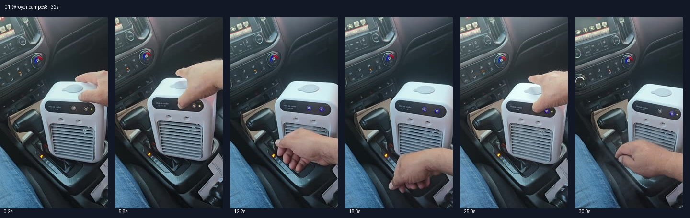

# 01 @royer.campos8 · 车里没空调的直接解决型

原视频：[打开 TikTok](https://www.tiktok.com/@royer.campos8/video/7498913909399735598)

处理状态：已完成

时长：约32秒；口播语言：西班牙语。

[本地视频](../../videos/01_royer.campos8_7498913909399735598.mp4)

## 发布文案原文

（原发布文案为空）

## 发布文案中文释义

原发布文案为空。

## 口播中文翻译

你的车没有空调吗？ 我给你带来了解决办法。 就是这台便携式迷你空调， 完全可以充电使用。 看，想带去哪里都可以。你看， 吹出来可真够凉的。 大家看看，怎么样？ 喜欢吗？去橙色购物车，买一台自己的吧。 有了它，以后在车里就不用再挨热了。 你们看看，怎么样？再看， 怎么样，凉得很。 厉害吧，朋友们，亲测推荐！

## 口播原文

¿Tu carro no cuenta con aire acondicionado? Te traigo la solución. Te traigo este mini aire acondicionado portátil totalmente recargable. Mira, te lo puedes llevar a donde tú quieras. Mira y enfría de a madre. Miren qué tal, ¿eh? ¿Les gustó? Vayan al carrito anaranjado y compren el suyo. Mira, ya no van a volver a pasar calor en su auto. Miren, eh, ¿qué tal? Y miren qué hubo. Enfría de a madres. Cabrón eh, ¡calado y recomendado mi gente!

## 大致拆解脚本

时间为大致段落划分，并非逐镜头剪辑点。

| 时间 | 画面动作 | 中文口播要点 | 该段作用 |
|---|---|---|---|
| 00:00–00:03 | 手持拍摄汽车中控，机器直接放在挡把旁。 | 提问车内没有空调，马上提出解决办法。 | 先限定使用人群。 |
| 00:03–00:08 | 镜头对准机器正面及顶部按钮。 | 介绍便携、可充电的小空调。 | 迅速交代产品和卖点。 |
| 00:08–00:15 | 手伸到出风口，近距离展示机器运行。 | 随身带走，强调凉感。 | 用手部反应提供感官暗示。 |
| 00:15–00:21 | 机器持续运行，手指向产品。 | 喜欢就点橙色购物车，车里不用挨热。 | 中段提前引导购买。 |
| 00:21–00:32 | 继续拍按键和出风口，重复伸手试风。 | 重复凉感，亲测推荐。 | 重复核心利益点收尾。 |

## 画面关键文字

无明显额外标题，主要展示产品本体。

## 记录说明

与第18条使用几乎相同的完整口播；第11条复用开头约15秒。

原文保留平台自动识别结果；中文按语境翻译。无法确认的词句已标记。价格、续航、销量、温度、功效及退货条件为原视频表述，未作事实核验。

