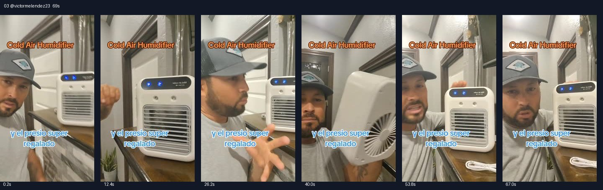

# 03 @victormelendez23 · 真人室内讲解型

原视频：[打开 TikTok](https://www.tiktok.com/@victormelendez23/video/7492282849702284590)

处理状态：已完成

时长：约69秒；口播语言：西班牙语。

[本地视频](../../videos/03_victormelendez23_7492282849702284590.mp4)

## 发布文案原文

#TikTokshop #viral #fyp #Melendez🇲🇽🧱 

## 发布文案中文释义

仅话题标签，无正文。

## 口播中文翻译

朋友们， 看看这个。 这东西真让人惊讶。 你们在哪里见过这种空调， 吹出来这么凉， 机身却这么小？ 你看看， 再看看， 风吹出来特别凉。 它可以用在哪里？卧室里， 浴室里、客厅里， 甚至你自己的车里。 看看它的另一个风速档位。 哎呀，朋友， 说真的，我还没见过这么一台空调， 这么一台， 又小、又好用、又便宜。 你自己现在也看见了， 凉风是怎么吹出来的。 说真的，你看， 它真的特别—— 看，你可以给它充电， 也能放在车里， 放客厅、放卧室。 它配有充电器， 可以充电使用。 所以朋友们，别再挨热了， 热天已经到了。 把这台小空调放在那里，你觉得怎么样？ 就放在， 你的床头， 或者皮卡车里。要是你的车没有空调， 说真的， 想放哪里都行。我百分之百推荐， 真的特别棒。 我可以， 保证你买了会很满意。 为什么？因为它吹出来真的很凉。

## 口播原文

Pues mi racita, chéquense nada más esto. Esto sí es algo increíble. ¿Dónde han visto ustedes un aire acondicionado que aviente bastante frío así? ¿Una cosa tan pequeña? Chécate nada más, mira, nada más, el aire sale superfrío. ¿Para qué sirve este? Lo puedes poner en tu recámara, en el baño, en la sala, en tu propio carro. Chécate la otra velocidad que trae. Mira, no hombre mi compita, la verdad la verdad que yo no había visto un aire acondicionado tan pequeño, tan bueno y tan barato. Tú ya lo estás mirando por ti mismo. ¿Cómo sale lo frío? La verdad que mira, está súper mira, lo puedes cargar en tu carro, ponerlo en tu sala, en tu cuarto. Viene con su cargador, es recargable, así es de que mi compita ya no pases más calores, el calor ya llegó. ¿Qué te parece este aire centralito? ¿Ahí en la cabecera de tu cama o en tu troca? Si no traes aire acondicionado, la verdad lo puedes poner donde tú quieras. Yo te lo recomiendo 100%, está supersuperpadrísimo. Yo te lo garantizo que vas a quedar bien satisfecho con esta compra. ¿Por qué? Porque enfría bastante

## 大致拆解脚本

时间为大致段落划分，并非逐镜头剪辑点。

| 时间 | 画面动作 | 中文口播要点 | 该段作用 |
|---|---|---|---|
| 00:00–00:12 | 戴帽男子与机器同框，机器靠近镜头。 | 小机器却能吹凉风，反复让观众看。 | 体积与效果反差制造兴趣。 |
| 00:12–00:22 | 机器正面特写，手指操作按键。 | 卧室、浴室、客厅、汽车都能放；展示另一风速。 | 拓宽场景并演示功能。 |
| 00:22–00:38 | 人脸和出风口来回切换，手在前面感受。 | 强调小巧、便宜、风凉。 | 用真人感受反复强化印象。 |
| 00:38–00:46 | 转动机器，展示侧后方和白色充电线。 | 可以充电，附充电器，方便移动。 | 解释使用门槛。 |
| 00:46–01:10 | 拿稳产品，面对镜头继续讲解。 | 热天可放床头或车里，保证满意并推荐。 | 场景代入和个人背书。 |

## 画面关键文字

Cold Air Humidifier＝冷风加湿器；y el presio super regalado＝价格非常实惠（原文拼写如此）。

## 记录说明

画面文字和口播均将产品称为冷风机或小空调；凉感为创作者表述。

原文保留平台自动识别结果；中文按语境翻译。无法确认的词句已标记。价格、续航、销量、温度、功效及退货条件为原视频表述，未作事实核验。

