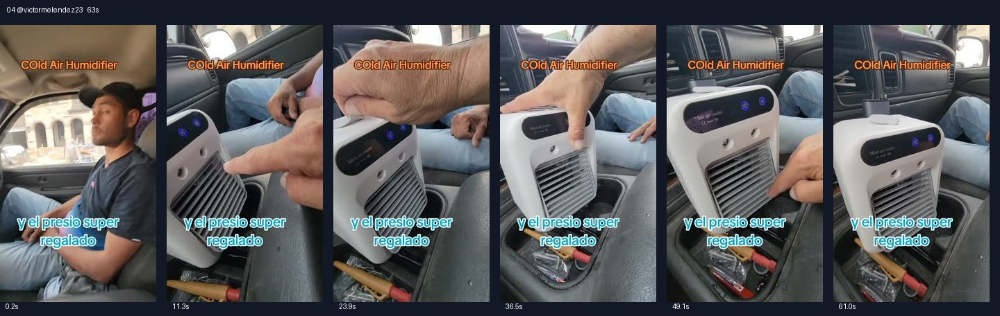

# 04 @victormelendez23 · 车载空调坏了的双人对话型

原视频：[打开 TikTok](https://www.tiktok.com/@victormelendez23/video/7497447920350825774)

处理状态：已完成

时长：约63秒；口播语言：西班牙语。

[本地视频](../../videos/04_victormelendez23_7497447920350825774.mp4)

## 发布文案原文

#TikTokshop #viral #fyp #Melendez🇲🇽🧱 

## 发布文案中文释义

仅话题标签，无正文。

## 口播中文翻译

小鸟，你看， 你把这台小空调， 开着呢？皮卡的空调怎么不开？ 哎呀，这台比皮卡原来的空调还凉。 别告诉我皮卡空调又不工作了。 那玩意根本不管用。 不是吧，兄弟， 看这里吹出来的， 凉得都这样了。那这个呢， 兄弟？你看，它还有一档。看， 就是这样。 这风可真凉啊，兄弟。 看，再调高一档。 哇，兄弟，Panchito，怎么样？ 是不是一下就凉了？ 是的，大家看，这里加冷水， 再加点冷水，就跟冰箱一样，对不对， 兄弟？真不错。 这可不是普通风扇， 是便携式小空调，想带走就带走。 看看，真不错， 哎，我把它关了。你可以把它放在卧室， 等一下，我再打开， 可以把它放卧室里。 也可以放客厅、厨房， 放车里，像我们一样，皮卡空调坏了，兄弟。 怎么样，真棒吧。 确实不错，你看。 朋友们看， 说真的，风量挺大，而且很凉，兄弟。 看，你看， 这个出风口还能上下调。 兄弟，有了这个， 在皮卡修好之前，至少就靠它了。 看，它， 真不错，朋友们，百分之百推荐。 小巧又高效，碰上这种情况就能用。

## 口播原文

Carito, ¿eh? Y este pinche aire, lo tienes prendido? ¿Y el de la troca? ¿Por qué no lo prendes? No, hombre, este güey enfría más que la de la pinche troca. No me digas que ya no jaló el de la troca. Ese güey, ni chinga ni sirve, no, chingues, cabrón, mira cómo sale aquí, de tan frío que está. Mira a la chingada, ¿y qué? Este, ¿qué? ¿Carnal? Mira, tiene otro volumen. Mira, esto es por eso, eh. Está bien frío este aire carnal, ¿eh? Mira, una velocidad más. Ah, cabrón, eh, carnal, panchito, ¿qué tal? ¿Se pone frío de volada? Sí, miren mi raza, aquí se le echa agüita fría, más, agüita fría. Y no, hombre, con eso, qué tal el congelador, ¿carnal? Hombre, queda chingón, ¿eh? Este no es un abanico, un icy carnal y portátil. Lo puedes cargar cuando tú quieras. Mira, nomás, no, hombre, ay, ya lo apagué para que lo pongas ahí, en tu cuarto. Deja, lo prendo para que lo pongas en tu cuarto. Mira, en la sala, en la cocina, en tu carro, como nosotros, que el de la troca no jaló, carnal, qué tal, pues, chingón, hombre, pues está chingón. Mira, miren mi raza, la verdad que avienta bastante aire, bien frío, carnal. Mira, mira, y esto se puede mover para arriba y para abajo. Mira, no, carnal, pues con este carnal, de que arreglamos la pinche troca, este menos vamos a traer. Mira Es chulada mi racita, la verdad que cien por ciento recomendable. Muy pequeño y muy eficiente para estos emergencias

## 大致拆解脚本

时间为大致段落划分，并非逐镜头剪辑点。

| 时间 | 画面动作 | 中文口播要点 | 该段作用 |
|---|---|---|---|
| 00:00–00:09 | 拍车内乘客和中控位置的机器。 | 两人对话：原车空调坏了，小机器能用。 | 用故障冲突引出产品。 |
| 00:09–00:23 | 手伸向出风口，按面板切换。 | 感叹凉风，演示不同档位。 | 对话反应配合功能展示。 |
| 00:23–00:31 | 镜头靠近顶部水箱。 | 顶部加冷水，强调便携。 | 说明使用方式。 |
| 00:31–00:45 | 机器在挡把旁运行，偶尔拍到乘客。 | 卧室、客厅、厨房、车内都能摆。 | 延伸使用场景。 |
| 00:45–00:54 | 手动拨动格栅，正面近拍。 | 风量大，可上下调出风方向。 | 展示可见功能。 |
| 00:54–01:03 | 回到机器全景。 | 修车之前先用它，强调小巧并推荐。 | 回扣故障场景。 |

## 画面关键文字

Cold Air Humidifier＝冷风加湿器；价格很实惠。

## 记录说明

原口播有较多粗口，中文保留调侃语气并适度弱化粗口。

原文保留平台自动识别结果；中文按语境翻译。无法确认的词句已标记。价格、续航、销量、温度、功效及退货条件为原视频表述，未作事实核验。

