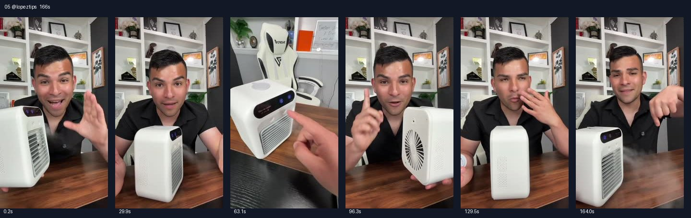

# 05 @lopeztips · 长口播详细种草型

原视频：[打开 TikTok](https://www.tiktok.com/@lopeztips/video/7514373443517697310)

处理状态：已完成

时长：约166秒；口播语言：西班牙语。

[本地视频](../../videos/05_lopeztips_7514373443517697310.mp4)

## 发布文案原文

El mejor aire acondicionado perfecto para tu cuarto o oficina! #aireacondicionado #tiktokshopcreatorpicks #tiktokshopfinds #airconditioner 

## 发布文案中文释义

最好的小空调，适合你的房间或办公室！原话题标签保留。

## 口播中文翻译

有了它，你的房间或办公室都快要出现企鹅了。 就是这台， 小小的空调， 便携、几乎没什么重量，最不可思议的是， 听好了，它不需要， 一直拖着电线，因为它可以充电。 什么？没错，朋友们， 就是你现在看到、听到的这样。而且你知道吗， 它可能是， 我这个夏天， 在 TikTok 买到的最划算的东西之一， 还不到 30 美元！ 我喜欢的是，它能给整个办公室， 或者整个房间带来凉意。 你也可以把它带上车， 比如你的车载空调不工作时。 还可以带去露营，带去任何地方， 因为它小巧， 也确实便携， 而且吹出来非常非常凉。 不过，朋友们， 可能更重要的是， 这个东西在这里卖得特别多， 已经卖出了超过 17,000 台， 就是在 TikTok 上卖的。说真的，太夸张了。 首先， 我喜欢它有一个操作面板， 可以控制风速， 也可以开机。 还有，我喜欢的是，如果你只想要—— 也有单独出水雾的模式。说实话，如果你把它放在， 晚上用，想让鼻子通畅一点，或者让毛孔打开，对吧？这个功能， 我确实很喜欢。另外，还有一个我觉得值得知道的地方， 就是这台不到 30 美元的小空调， 它不用一直拖着线，也不用一直插电， 或者说， 有时候你去的地方没地方插电，对吧？ 它是无线的， 你可以提前充好电， 充一次可以用 4 到 7 个小时， 说真的， 挺厉害的。 最后还有很重要的一点，它的上面， 这台小空调上面有个水箱， 可以往里面加水， 这样就能出水雾。 我建议你，水， 越冰，吹出来的风就越凉，对吧？ 加一小瓶水进去， 可以连续使用好几个小时， 具体也要看天气。 如果天气特别热，我就用更冰的水， 如果我想让鼻子通畅一点， 我会用稍微温一点的水， 再加一点 Vicks， 就好了。 说真的，我很喜欢它， 主要会放在办公室用， 有点不舒服的时候， 或者去露营的时候。 都很合适， 朋友们，不到 30 美元，我觉得很值。 你可以在 TikTok 商店买到， 如果你想送给爸爸，这也是很合适的礼物， 父亲节马上就到了， 或者送给有需要的朋友。 这东西挺合适， 便携、小巧， 但是能派上用场。 记住，如果你想买， 链接就在视频下方。

## 口播原文

Hasta pingüino van a salir en tu cuarto o tu oficina con este aire acondicionado que es pequeño, es portátil, no pesa absolutamente nada y lo más increíble escucha esto es que no necesita ningún cable porque es recargable. ¿Qué? Sí mi gente así como estás viendo y estás escuchando y saben algo, ¡este posiblemente una de las mejores compras que yo he hecho aquí en tiktok en este verano por menos de $30! Ahora lo que me encanta es que puede enfriar una oficina completa, un cuarto completo. Puedes llevarlo posiblemente en tu carro. Si en caso pues no te funciona, puedes llevarlo a acampar a cualquier lugar porque es pequeño, obviamente portátil y hielo muy pero muy frío. Pero ahora mi gente y posiblemente lo más importante porque este producto aquí se ha vendido tanto que sí más de 17000 unidades vendidas aquí en tiktok tokio. Honestamente es una locura. Para comenzar, me encanta porque tiene su panel donde puedes controlar la velocidad o por ejemplo prenderlo. ¿Ahora lo que me encanta es que si solo quieres humito también tiene esa opción que honestamente es perfecto si lo pones en la noche para que te destape la nariz o que te abra los poros, ¿verdad? Esa función honestamente me encanta. Ahora, y otra cosa que honestamente vale la pena conocer de este airecito por menos de treinta dólares es que no necesita un cable o estarlo conectando en la corriente o posiblemente estás en un lugar que no tienes cómo conectarlo verdad? Es inalámbrico, lo puedes cargar y con una sola carga te puede durar de 4 hasta 7 horas, honestamente increíble. Y por último y muy importante, en la parte de arriba, este aire acondicionado tiene como una base para meterle agua, ¿verdad? Para que salga el humito. Yo te ¿Recomiendo que entre más helada el agua más frío va a salir el aire verdad? ¿Y con una botellita que le metas te puede durar horas y horas sin parar dependiendo del clima verdad? Si está muy pero muy caliente yo lo pongo más helado, pero si quiero como destapar mi nariz yo lo pongo un poquito calentito, con un poquito de vix y solucionado. Honestamente esto me encanta y yo lo uso más para tenerlo aquí en mi oficina, cuando estoy un poco enfermo o cuando voy a acampar. Es perfecto mi gente, ¿por menos de $30 siento que esto vale la pena eh? Lo pueden conseguir aquí en la tienda de tiktok y también es un regalo perfecto si quieres regalárselo a tu papá que ya viene el día del padre o algún amigo que lo necesite. Esto es perfecto, portátil, pequeñito, pero haz el trabajo. Recuerda que si lo quieres comprar el enlace está en la parte de abajo del video

## 大致拆解脚本

时间为大致段落划分，并非逐镜头剪辑点。

| 时间 | 画面动作 | 中文口播要点 | 该段作用 |
|---|---|---|---|
| 00:00–00:17 | 黑衣男子在桌前拿起机器。 | 企鹅式夸张开头，交代小巧、轻便、可充电。 | 先用结果吸引，再概括卖点。 |
| 00:17–00:57 | 真人持机讲解。 | 不到30美元，列举办公室、房间、汽车、露营，提及销量。 | 价格锚点加多场景和销量背书。 |
| 00:57–01:25 | 切换到操作面板和机器近景，再回到人物。 | 演示开关、风速和单独水雾功能。 | 把抽象卖点转成可见操作。 |
| 01:25–01:44 | 拿起并转动机器，展示无线使用。 | 不用一直插电，称充一次能用4至7小时。 | 解释便携的具体好处。 |
| 01:44–02:16 | 展示顶部水箱，边讲边用手比划。 | 如何加水以及创作者自己的用法。 | 补充操作细节；原视频含未经验证的健康表述。 |
| 02:16–02:46 | 回到人物正面，手指向视频下方。 | 办公室、露营、父亲节礼物，不到30美元，链接在下方。 | 用送礼场景和行动引导结束。 |

## 画面关键文字

主要为真人讲解和机器功能特写。

## 记录说明

01:06–01:25由原音补转写。不到30美元、销量17000台、续航4至7小时均为原视频说法；关于通鼻、毛孔和Vicks的内容仅按原意翻译，不作为使用建议。

原文保留平台自动识别结果；中文按语境翻译。无法确认的词句已标记。价格、续航、销量、温度、功效及退货条件为原视频表述，未作事实核验。

