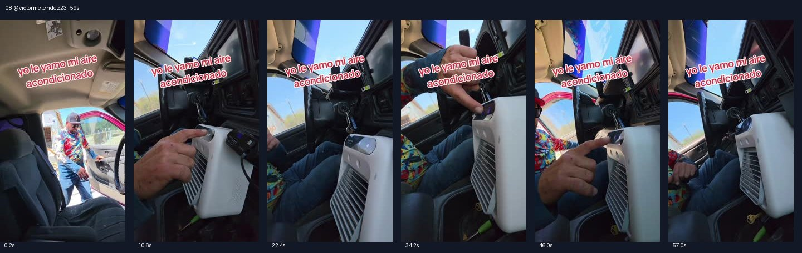

# 08 @victormelendez23 · 车门旁即兴对话型

原视频：[打开 TikTok](https://www.tiktok.com/@victormelendez23/video/7621259428557278477)

处理状态：已完成

时长：约59秒；口播语言：西班牙语。

[本地视频](../../videos/08_victormelendez23_7621259428557278477.mp4)

## 发布文案原文

#tiktokshop #viralvideo #fyp #paratiiiiiiiiiiiiiiiiiiiiiiiiiiiiiii 

## 发布文案中文释义

仅话题标签，无正文。

## 口播中文翻译

走了，走了，兄弟。 你可真行。 这也太热了， 怎么不开空调？不工作。 怎么会不工作？哦，你说皮卡那个。车上的不行，这台可以。看， 哇，这是什么？便携式空调？看， 那怎么不把这个打开？ 我还以为是在擦什么呢。[此处平台字幕不清] 不是，看，是便携式的。 甚至不用把皮卡发动起来，你看， 怎么样，这凉风吹得， 看，都吹到这边了。 看看，兄弟，能看见吧， 看见没有？看见了，Panchito。 我喜欢的是， 你看，哪里都能带着， 你看， 看看。需要充电就给它充电，不需要就不用插着。 往牛仔哥那边吹吹， 看，能吹得到，太爽了，你看， 而且还有不同风速， 看见没有，看见没有， 看吹出来这些。 我关掉了，我关掉了，等一下， 等等。好了，好了，好了，好了。 怎么样，出来了没有？ 出来了。哎，Panchito， 看看，哈哈哈。 够不够凉？太棒了，这台我就——[视频结束]

## 口播原文

Vámonos, vámonos, güero. Ya ni chingas. Pinche calorón, güey. Y por qué no prendes el aire acondicionado, ¿no? Jala, ¿cómo no? Jala. Oh, de la troca, no, güey, pero este sí, güey. Mira, ah, chinga, ¿y ese qué? ¿Es? ¿Un aire acondicionado portátil? Mira, ¿por qué no lo prenden ese? Yo pensé que iba tallando, eh. No es. Mira, es un portátil. Es más, no ocupas ni la ni la troca prendida. Mira, qué tal, mira cómo avienta lo frío. Mira, hasta acá llega. Mira cuál carnal, ¿eh? Se mira, ¿lo miras o no? Sí, ahí se ve, Panchito. Mira, lo que me gusta, que mira, lo puedes traer en todas partes. Mira, guáchate, nada más. Ya. Si ocupa, carga, le metes carga, pero si no, no. Pero aviéntale lo frío para el vaquerito, no, casi llega ahí, llega de toda madre, güey, mira, y tiene velocidades, güey, eh, lo miras, lo miras. Todo lo que sale, lo pagué, lo pagué, espérate, espérate. Ahí está. Ahí está. Ahí está, ahí está. Sí, sale o no sale. Sí, no, Panchito, chécate, nada más. Mira, ja, ja, ja, ja. Así o más frío, ¿no? Pues está perrona. Ese me lo

## 大致拆解脚本

时间为大致段落划分，并非逐镜头剪辑点。

| 时间 | 画面动作 | 中文口播要点 | 该段作用 |
|---|---|---|---|
| 00:00–00:09 | 从车门外的人拍到车内机器。 | 催出发、抱怨热、原车空调不工作。 | 用日常对话建立冲突。 |
| 00:09–00:20 | 指向机器顶部并按键。 | 便携空调，不用发动汽车也能工作。 | 解释替代使用场景。 |
| 00:20–00:34 | 近拍出风口与乘客反应，机器被挪动。 | 互相确认风量，强调可到处带和充电使用。 | 人物互动和移动演示。 |
| 00:34–00:46 | 机器放中控附近，手调整面板。 | 向另一个人送风，展示档位。 | 多人体验强化感受。 |
| 00:46–00:59 | 持续拍机器运行，众人笑。 | 重新打开、确认出风，口头夸赞。 | 情绪收尾；无完整独立购买口令。 |

## 画面关键文字

yo le llamo mi aire acondicionado＝我把它叫作我的空调。

## 记录说明

结尾口播被视频截断；有一处西语平台字幕不清，译文已标记。

原文保留平台自动识别结果；中文按语境翻译。无法确认的词句已标记。价格、续航、销量、温度、功效及退货条件为原视频表述，未作事实核验。

