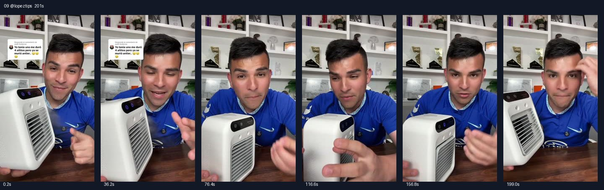

# 09 @lopeztips · 回复评论并处理质疑型

原视频：[打开 TikTok](https://www.tiktok.com/@lopeztips/video/7514888112246426911)

处理状态：已完成

时长：约201秒；口播语言：西班牙语。

[本地视频](../../videos/09_lopeztips_7514888112246426911.mp4)

## 发布文案原文

Respuesta a @Judit Gutierrez el mejor aire acondicionado inalámbrico para cualquier ocasión #aireacondicionado #airconditioner #tiktokshopcreatorpicks #tiktokshopfinds 

## 发布文案中文释义

回复 @Judit Gutierrez：适用于各种场合的无线便携小空调。原话题标签保留。

## 口播中文翻译

我手上拿着的，可能是， 我这个夏天， 买得最满意的东西之一， 在 TikTok 商店买的，还不到 30 美元， 我觉得这价格真夸张。 没错，朋友们，我们说的就是一台， 便携、无线的小空调， 说实话，我以前都没见过、也没用过这种东西。 那么， 我很喜欢的一点，是它有不少好评， 比如她这条评论写着， 我以前有一台，用了 4 年，前天才坏。 它们确实挺不错， 吹出来确实很凉。 接下来，我跟你们说实话， 我喜欢这台小空调的地方， 除了小巧、几乎没什么重量， 还可以在顶部加水。 给你一个建议，水越冰， 吹出来的水雾就越凉。 或者吹出来的风。 我喜欢的一点，是它能放在办公室，也可以放在， 卧室、车里，去露营也能带着，你想得到的各种场合都行。 不过在这之前，朋友们，我想聊一个很重要的话题，我就用这台小空调， 作为例子。 上次我发过一条视频或者帖子， 讲这台小空调， 也确实推荐了它。 后来我看评论， 有不少人说这个产品不好， 说没用，或者有各种问题， 所以我想说的是， 你们也知道，这些产品卖得， 在 TikTok 商店一卖就是成千上万台，对吧？ 有时候、有的情况， 可能一大批里面会有一台不好， 或者有瑕疵， 或者不能用。 作为一个内容创作者， 我在这方面已经做了好几年， 在 TikTok Shop， 给大家推荐东西。我拿到产品之后， 如果我用着有效，我才会推荐， 如果东西不好用，我就不会推荐。[原字幕后半句有误] 我一直都在视频或者帖子里说， 你们要读一读、看一看评价， 看看评论是好是坏， 看看评分，这些在链接里都能看到。 产品是好是坏，买过的人自己会说。 我觉得这也是很平常的做法，对吧？ 你们买别的东西也可以这么做。 如果买来的产品不工作， 在 TikTok 这里， 如果不能用， 你可以退货，然后申请退款。 我以前已经做过视频，教大家怎么， 把产品寄回去、办理退货。如果你需要， 我也可以再把那条视频给你们看。 所以朋友们，我就是想把这个说清楚， 因为有时候我推荐一个东西，别人会说， 哦，我买了没用， 这个那个。但对我来说，它是能用的。 当然它不可能把你整栋房子都吹得冰凉，对吧？ 因为这只是一台 30 美元的小空调， 道理很简单。 但如果你放在，比如， 我自己就会在， 办公室工作的时候，把它放面前， 就放这里。 我觉得挺舒服，电池大概能用 4 到 5 个小时。 当然不可能让整个地下室都凉下来，对吧？ 这很明显。但你想放在办公室， 放床前， 放车里，这么一个小东西， 就能派上用场。 所以朋友们，如果你想要， 反正我是用着有效， 我觉得挺不错， 还不到 30 美元。 点击视频下方的链接就可以买到。 如果你买了不能用， 可以退回去、退货，再申请退款。 大家知道就行了。

## 口播原文

En mis manos tengo la que podría ser una de las mejores compras que yo he hecho todo este verano aquí en la tienda de tiktok por menos de $30, que creo que es una locura. Y sí mi gente, estamos hablando de un aire acondicionado portátil inalámbrico que la verdad yo nunca había visto o tenido uno de esto ahora. Y lo que me encanta es que hay muchos comentarios positivos, por ejemplo el de ella dice, yo tenía uno, me duró 4 añitos pero se me murió antier. Es que la verdad estos son increíbles y la verdad enfría muchísimo ahora y le voy a ser muy honesto, lo que me encanta de este aire aparte lo pequeño no pesa absolutamente nada, le puedes agregar agua en la parte de arriba y un consejo, entre más helada la agua pues más helado pues va a salir como el vapor. o el aire. Una de las cosas que me encanta es que puedes usarlo en tu oficina, puedes usarlo en tu cuarto, puedes usarlo en tu carro, cuando vas a acampar, en cualquier ocasión que tú imaginas. Pero antes, mi gente, quiero tocar un tema que es muy importante y voy a usar este aire acondicionado como ejemplo. La vez pasada hice un video o una publicación hablando de este airecito recomendando la verdad y estaba viendo los comentarios que muchas personas decían que este producto era malo, que no funcionaba esto y lo otro, y quiero decirles esto, como ustedes saben, estos productos se venden, se venden miles y miles aquí en la tienda de tiktok, ¿verdad? Y hay veces o hay ocasiones que posiblemente de 10001 va a salir malo, o simplemente defectuoso o que no sirva. Yo, siendo un creador de contenido que llevo años de experiencia en tiktok show recomendando cosas obviamente yo Recibo el producto, si a mí me funciona yo lo voy a recomendar, pero si algo no me funciona no va a funcionar. Siempre he dicho en mis videos o en mis publicaciones que lean o miren la reseña, los comentarios, si son positivos o negativos, que miren las estrellas y ustedes lo pueden ver en el enlace. Si el producto es bueno o malo, ¿las personas mismos dicen ahora y creo que es lo más común verdad? Y lo pueden hacer en todas partes. ¿Si un producto no funciona que digamos que compran verdad? Aquí en tiktok si no funcionan pueden retornarlo y pueden recibir su dinero para atrás. Ya he hecho videos enseñando cómo pueden entregar un producto o regresar un producto si necesitan. Otra vez ese video lo puedo mostrar, así que mi gente quería como decir eso porque hay personas que a veces cuando recomiendo algo dicen, oh, no me funcionó esto otro. A mí en mi caso esto sí me ha funcionado. ¿Obviamente no te va a dar la casa verdad? Porque es un aire acondicionado de $30, es como común, pero si lo pones por ejemplo, yo lo uso cuando estoy trabajando aquí enfrente de mi oficina, lo pongo aquí. Yo siento rico y la batería me dura de 4 hasta 5 horas. ¿Obviamente no te va helar un baseman verdad? Es obvio, pero si lo quieres poner como tu oficina, enfrente de tu cama, en tu carro, esta cosita sí te va a Funcionar, así que mi gente si lo quieren porque a mí sí me ha funcionado, está buenísimo, menos de $30. Lo puedes comprar el enlace en la parte de abajo del video y si no te funciona puedes entregarlo o devolverlo y te regresan el dinero, así que ya saben

## 大致拆解脚本

时间为大致段落划分，并非逐镜头剪辑点。

| 时间 | 画面动作 | 中文口播要点 | 该段作用 |
|---|---|---|---|
| 00:00–00:32 | 蓝衣男子持机，画面保留用户评论。 | 不到30美元的购买经历，读出用了4年的好评。 | 价格加第三方体验建立信任。 |
| 00:32–01:08 | 展示顶部加水位置和机器正侧面。 | 机身轻、水越冷体验越凉，列举办公室、卧室、汽车、露营。 | 功能演示与场景延伸。 |
| 01:08–01:49 | 人脸近景，手持产品解释。 | 回应说产品不好用的评论，说明自己的推荐标准。 | 处理信任和质量异议。 |
| 01:49–02:30 | 保持真人口播，偶尔指向观众。 | 建议看评价和评分，讲退货退款。 | 降低购买顾虑。 |
| 02:30–03:04 | 把产品放面前，继续持机说明。 | 明确不能吹凉整栋房子，适合近距离个人使用；称续航4至5小时。 | 收窄效果预期。 |
| 03:04–03:21 | 面对镜头点头、指向下方。 | 再报不到30美元、下方链接和退货说法。 | 带着异议处理结果引导购买。 |

## 画面关键文字

置顶评论：我之前有一台，用了4年，前天才坏。

## 记录说明

00:49–01:08由原音补转写；退货退款是原视频当时的说法，非对当前订单的保证。

原文保留平台自动识别结果；中文按语境翻译。无法确认的词句已标记。价格、续航、销量、温度、功效及退货条件为原视频表述，未作事实核验。

