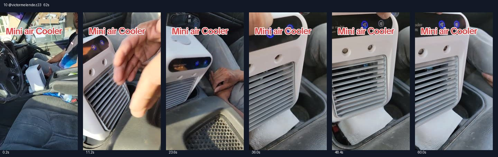

# 10 @victormelendez23 · 不愿坐热车的三人情景型

原视频：[打开 TikTok](https://www.tiktok.com/@victormelendez23/video/7499263025996926254)

处理状态：已完成

时长：约62秒；口播语言：西班牙语。

[本地视频](../../videos/10_victormelendez23_7499263025996926254.mp4)

## 发布文案原文

#tiktokshop #viral #fyp #Melendez🇲🇽🧱 

## 发布文案中文释义

仅话题标签，无正文。

## 口播中文翻译

小鸟，走了，走了， 走，出发， 上车走吧。 不，我要， 坐那个人的车， 你这台， 皮卡连空调都没有，根本不工作。你看， 不是吧，Víctor， 看看这个东西， 你看，Víctor，有这个就行。 这就是我买来的小空调，Víctor。 不是吧，兄弟，看看， 哇，这真的特别凉。让我试试， 哇，你可真行，兄弟。 Panchito，这就是给皮卡降温的那台空调？ 没错，牛仔哥。 Víctor，这比皮卡原来的空调还凉。 不是吧， 兄弟，不—— 那我跟你们走。真有这么凉？真的，你看， 凉得很，你看， 而且是便携的。 便携的。你看， 哎呀，牛仔哥。 那你到底在哪里买的？ 你看，风挺大，还能调风速， 就在 TikTok Shop，那边有卖。 兄弟， 说真的，真的，那我们， 还修那个坏空调干什么？ 有这个就够了，还折腾那些做什么。 看看， 兄弟，说实话，你真让我惊讶。 风挺大，而且还能调档位。没错， 兄弟，你看看， 这不是普通风扇， 这是一台小空调，兄弟。 朋友们，说真的，我们推荐，推荐。 牛仔哥，对不对？百分之百。 看看，这风吹得真不错。

## 口播原文

Pajarito, vámonos, fuga, fuga, vámonos, a la chingada, súbete, vámonos, no, yo voy con aquel, güey, esta pinche, troca, no trae ni pinche, aire, güey, no, le jala. Mira, güey, no, hombre, víctor, mira, chingadera, mira, mira, víctor, con esto, qué, este aire que me encargué, víctor, no, chingues, carnal, mira, nomás, mira, no mames, güey está superhelado, güey, a ver, no, mira, no te pases de lanza, carnal, a poco, este es el aire que les enfrenta a la troca. Panchito, sí, no mames, vaquerito, este víctor te enfría mejor que el de la pinche. Troca, no, chingues, güey, no, me voy con ustedes, a poco, sí, güey no mira bien, chingón, mira bien, friito, mira, no, mames, es portátil, es portátil. Mira, no pinche, vaquerito. Y dónde lo compra, ¿a la chingada? Oye, güey, mira avienta de a madre, güey tiene velocidades, güey, aquí, en tiktok shop, ahí los venden, eh, carnal, la neta, la neta, que, ¿para qué? ¿Arreglamos el pinche? No, hombre, con eso tenemos, güey, para qué quieres, chingaderas, mira, nomás, no, carnal, la neta, la neta, que me has dejado sorprendido, avienta, bastante, y tiene velocidades, sí, no, carnal, mira todo, no, hombre, este no, este no es un abanico, este es un aire central, carnal, no, mi racita, la neta, que sí, lo recomendamos, lo recomendamos, sí o no, vaquerito, cien por ciento, mira, nomás, chingos, que avienta está chingón

## 大致拆解脚本

时间为大致段落划分，并非逐镜头剪辑点。

| 时间 | 画面动作 | 中文口播要点 | 该段作用 |
|---|---|---|---|
| 00:00–00:08 | 拍车门、乘客和中控机器。 | 有人不想坐没有空调的皮卡，另一个人拿出小空调。 | 用拒绝上车制造开场冲突。 |
| 00:08–00:24 | 多只手伸到出风口，镜头在机器与人物间切换。 | 试风、惊讶，然后改口一起坐。 | 通过态度反转表现吸引力。 |
| 00:24–00:35 | 机器正面近拍，手指按键。 | 便携、问购买渠道、回答TikTok Shop并展示档位。 | 把功能和购买入口放进对话。 |
| 00:35–00:50 | 机器持续运行，人物继续调侃。 | 有这个就先不修旧空调了，反复强调风量。 | 回扣故障痛点。 |
| 00:50–01:03 | 出风口特写。 | 不是普通风扇式的口头强调，多人表示推荐。 | 重复品类印象和集体背书。 |

## 画面关键文字

Mini air Cooler＝迷你冷风机。

## 记录说明

同系列多人车内情景，与第4、8、25条的共同点是先抱怨再试风。

原文保留平台自动识别结果；中文按语境翻译。无法确认的词句已标记。价格、续航、销量、温度、功效及退货条件为原视频表述，未作事实核验。

