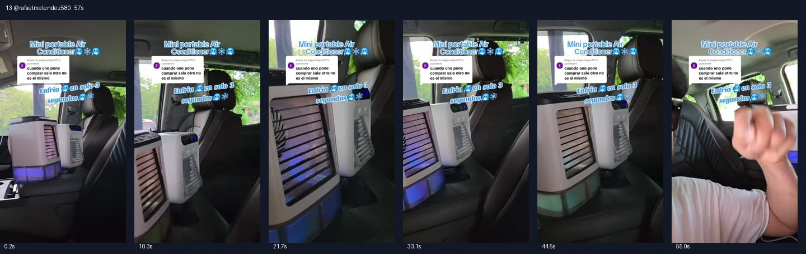

# 13 @rafaelmelendez580 · 购买选项不一致的答疑型

原视频：[打开 TikTok](https://www.tiktok.com/@rafaelmelendez580/video/7501085032421805343)

处理状态：已完成

时长：约57秒；口播语言：西班牙语。

[本地视频](../../videos/13_rafaelmelendez580_7501085032421805343.mp4)

## 发布文案原文

Replying to @edgaredgar317 #Portable Air Conditioner 3-in#tiktokshop #fyp #viral #MELENDEZ🇲🇽🧱🇺🇸 

## 发布文案中文释义

回复 @edgaredgar317：便携式三合一小空调。原话题标签保留。

## 口播中文翻译

来，这位朋友说，一点购买就出来另一款， 和视频里的不一样。朋友，你说得完全对。为什么呢？ 因为你点进购物车之后， 会看到 A 款和 B 款，两款我都， 特别推荐。 看看这台小空调，多漂亮。 一开始通常显示的是这一款， 然后你往旁边划，就能看到 B 款。 两台我都很推荐， 因为吹出来的风， 确实都很凉。 你们看，百分之百推荐。 至于 A 款， 就是大家现在都在买的经典款。 说真的，很难选， 因为它们能让家里、车里， 都变得凉快，朋友们。 所以朋友们， 现在大家买这个， 主要是给房间降温，睡觉， 睡得舒服一些。 朋友们，或者放车里， 车上空调不太管用的时候， 小朋友又觉得热， 我推荐你用这个便携空调。看这里， 有 USB，可以充电，电池也很耐用， 或者你可以接到车上的 USB， 没什么麻烦，就能给车里送凉风。 朋友们， 所以点一下链接，赶紧下单吧，朋友们。

## 口播原文

A ver, aquí el compita dice cuando uno pone comprar sale otro, no es el mismo amigazo tiene 100% toda la razón. ¿Y por qué? Porque cuando usted le da clic ahí en el carrito le aparece opción a y opción b y los 2 son supersuperrecomendados. Mire nada más esta chulada de aire acondicionado, es que siempre le va a aparecer este y luego le va recorriendo y le va a aparecer el opción b que los 2 se los recomiendo al millón porque avientan el aire, lo que se dice bien pero bien friito. Miren nada más 100% recomendados y el opción a, mire este es el tradicional que todos están comprando, la verdad que ni a cuál irle porque dejan la casa los carros bien bien congelados mi raza, así que mi racita ahorita es lo que todos están comprando para enfriar sus habitaciones y dormir bien bien tranquilo mi raza o en el carro cuando el aire acondicionado no está funcionando bien y los niños tienen calor, les recomiendo este aire portable que miren aquí tiene su usb, lo puede recargar y la pila le dura muchísimo o lo pueden conectar al usb de su carro sin ningún problema y enfriar el carro al 100% mi raza, así que mi racita, denle clic y encárguenlos, pero ya mi raza

## 大致拆解脚本

时间为大致段落划分，并非逐镜头剪辑点。

| 时间 | 画面动作 | 中文口播要点 | 该段作用 |
|---|---|---|---|
| 00:00–00:07 | 车内两台机器并排，顶部保留评论框。 | 读出点购买后出现另一款的疑问，并先承认。 | 直接接住购买障碍。 |
| 00:07–00:21 | 镜头在两台机器之间移动。 | 解释商品链接里有A、B两个选项，横向选择。 | 解决款式匹配问题。 |
| 00:21–00:35 | 手指向两台机器的格栅和水箱。 | 两款都推荐，分别展示。 | 比较选项并给出推荐。 |
| 00:35–00:49 | 车内机器正面特写，展示接口和供电线。 | 卧室睡觉、车内使用，USB充电。 | 结合场景解释使用方式。 |
| 00:49–00:57 | 机器继续运行，镜头回到人物。 | USB连接汽车，点击链接下单。 | 把答疑转为行动。 |

## 画面关键文字

Mini portable Air Conditioner＝迷你便携空调；Enfría en solo 3 segundos＝只需3秒就能送凉风（原画面宣传）。

## 记录说明

画面中实际并排放置两种不同外观的产品，因此需要在拆解中区分A/B款。

原文保留平台自动识别结果；中文按语境翻译。无法确认的词句已标记。价格、续航、销量、温度、功效及退货条件为原视频表述，未作事实核验。

