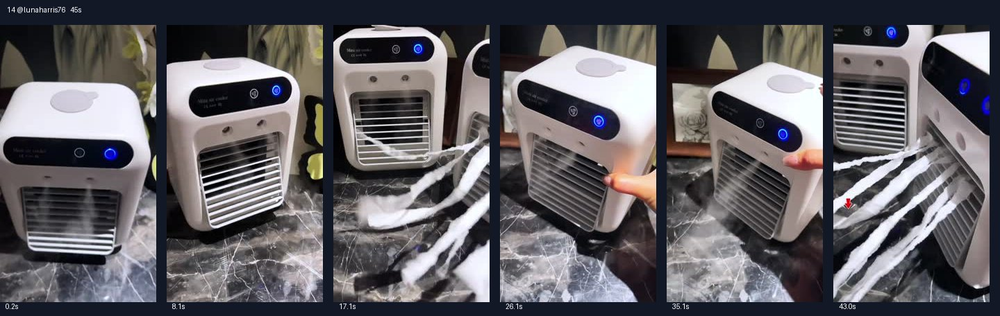

# 14 @lunaharris76 · 纸条风力证据型

原视频：[打开 TikTok](https://www.tiktok.com/@lunaharris76/video/7634482525678652686)

处理状态：已完成

时长：约45秒；口播语言：西班牙语。

[本地视频](../../videos/14_lunaharris76_7634482525678652686.mp4)

## 发布文案原文

🎊Enfriador de tendencia que lamentarás no comprar!#summervibes☀️ #VentiladorDeNiebla #refreshedlook #tiktokshopmothersday #fan 

## 发布文案中文释义

不买可能会后悔的热门冷风机！原话题标签保留。

## 口播中文翻译

你的房间都快要出现企鹅了。 这绝对是， 我在 TikTok Shop 最满意的一次购物。 花了， 不到 30 美元，买的是一台迷你空调， 但它凉得我手都快冻住了。 它能给一个房间， 客厅或者办公室带来很好的凉意。 它很小，但很有劲。 它有一个， 可以调节风速的控制面板， 也能选择开不开制冷模式。 我只需要， 往上面加水，就可以用了。 另外你看， 它是无线的。 出风格栅可以随意调节。 它现在正在优惠， 抓紧吧，因为我不知道这个价格能持续多久。 链接就在这里的橙色购物车。

## 口播原文

hasta los pingüinos van a salir a tu habitación esta es definitivamente mi mejor compra en tiktok shop me costó menos de treinta dólares y es un mini aire acondicionado pero me congela la mano puede enfriar una habitación una sala o una oficina a la perfección es superpequeño pero muy potente tiene un panel de control donde puedes ajustar la velocidad del ventilador y también si quieres que esté climatizado o no solo tuve que agregar agua aquí arriba y está listo para usar además fíjate es inalámbrico esta parrilla se mueve como quieras si está en oferta ahora mismo aprovecha porque no sé cuánto durará este precio lo dejo aquí en el carrito naranja

## 大致拆解脚本

时间为大致段落划分，并非逐镜头剪辑点。

| 时间 | 画面动作 | 中文口播要点 | 该段作用 |
|---|---|---|---|
| 00:00–00:11 | 桌面机器近景，按键亮起。 | 企鹅夸张开头、TikTok购买、不到30美元。 | 把夸张利益点与价格连在一起。 |
| 00:11–00:21 | 纸条在格栅前飘动，机身保持全景。 | 房间、客厅、办公室，体积小但有劲。 | 用可见风力承接口播。 |
| 00:21–00:29 | 手按控制面板。 | 调节风速和模式。 | 逐个说明功能。 |
| 00:29–00:38 | 指顶部水箱，再按键并调整格栅。 | 加水、无线、出风角度可调。 | 完整展示基础使用步骤。 |
| 00:38–00:45 | 镜头回到纸条和两台机器，出现箭头。 | 优惠正在进行，橙色购物车。 | 促销加明确购买入口。 |

## 画面关键文字

机身可见Mini air cooler字样，末尾向下箭头。

## 记录说明

与第6条核心话术相同，语速更慢；纸条是风量演示，不能作为温度实测。

原文保留平台自动识别结果；中文按语境翻译。无法确认的词句已标记。价格、续航、销量、温度、功效及退货条件为原视频表述，未作事实核验。

