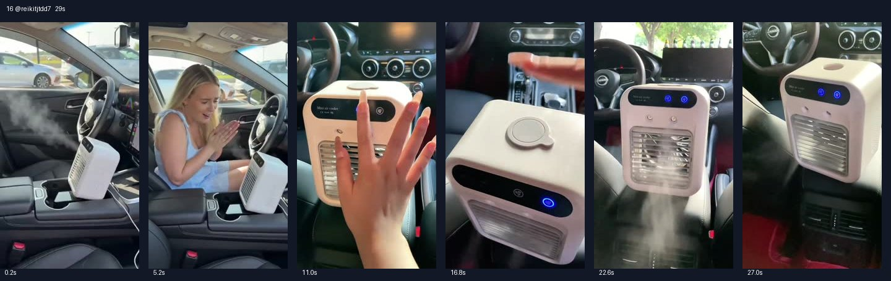

# 16 @reikitjtdd7 · 女生车内惊讶反应型

原视频：[打开 TikTok](https://www.tiktok.com/@reikitjtdd7/video/7644778116090580238)

处理状态：已完成

时长：约29秒；口播语言：英语。

[本地视频](../../videos/16_reikitjtdd7_7644778116090580238.mp4)

## 发布文案原文

Why go broke trying to fix your car A/C #MiniAirConditioner #PortableAirCooler #RoomCoolingHack #USBRechargeableFan #tiktokshopspringglowup 

## 发布文案中文释义

修车载空调，何必把钱都花光？原话题标签保留。

## 口播中文翻译

等等， 这里怎么真的这么冷？ 这也太凉了。 这台便携式小空调[此处英文不清]，能达到 20 度。 太夸张了。可以放车里， 放公寓里， 也可以放办公室。 你看，它有[此处英文不清，疑似加湿功能]， 水箱能用 5 到 7 个小时。 而且它可以充电，不用一直插着电。 充满电以后， 能用 8 个小时。 太夸张了。[此处英文不清] 你现在真该去看看。

## 口播原文

Wait, why is it actually freezing in here? This is freezing cold. This portable AC ray chicken reach up to 20 degrees. It's crazy. You can use it in your car, you can use it in your apartment, you can use it in your office. Look at this. It has a mini fire and a water tank that will last you five to seven hours. And this is rechargeable, so you don't have to plug it in all the time. And when it is fully charged, it is going to last you 8 hours. This is so crazy. I'm making a Dunkin of the cereal you definitely need to check out right now.

## 大致拆解脚本

时间为大致段落划分，并非逐镜头剪辑点。

| 时间 | 画面动作 | 中文口播要点 | 该段作用 |
|---|---|---|---|
| 00:00–00:04 | 先拍车内机器出雾，人物尚未正面说话。 | 前段以运行画面吸引注意。 | 视觉效果先于口播。 |
| 00:04–00:09 | 女生在驾驶座惊讶、搓手。 | 为什么这里这么冷？真的很凉。 | 用人物反应建立情绪。 |
| 00:09–00:16 | 按键、格栅和车内摆放位置近拍。 | 提到20度以及汽车、公寓、办公室。 | 数字钩子加场景扩展。 |
| 00:16–00:23 | 顶部水箱、机器正面与供电线特写。 | 水箱5至7小时，可充电，不必一直插电。 | 集中解释使用便利。 |
| 00:23–00:29 | 机器持续出风，镜头拉回。 | 称充满能用8小时，呼吁去看看。 | 续航利益点和简短行动引导。 |

## 画面关键文字

主要为车内产品和真人反应，没有独立的长标题。

## 记录说明

英文有几处发音或配音不清，平台字幕和再次识别均未能确认，已在中文标明。20度未说明温标。

原文保留平台自动识别结果；中文按语境翻译。无法确认的词句已标记。价格、续航、销量、温度、功效及退货条件为原视频表述，未作事实核验。

