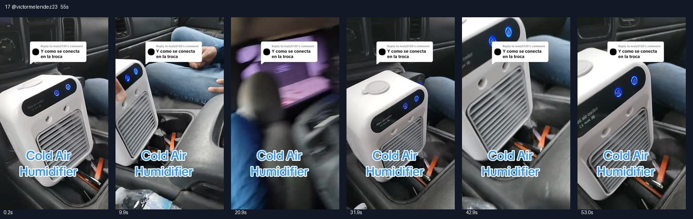

# 17 @victormelendez23 · 车上怎么接电的答疑型

原视频：[打开 TikTok](https://www.tiktok.com/@victormelendez23/video/7502236009959066926)

处理状态：已完成

时长：约55秒；口播语言：西班牙语。

[本地视频](../../videos/17_victormelendez23_7502236009959066926.mp4)

## 发布文案原文

Replying to @maly5130 #tiktokshop #viral #fyp #Melendez🇲🇽🧱 

## 发布文案中文释义

回复 @maly5130。正文为话题标签。

## 口播中文翻译

朋友问，它在皮卡里怎么接电？朋友， 它是便携的， 不用一直接着。嗯，是可以充电的， 可以充电。 你看，看看， 想把它挪到哪里都行， 看看，你看， 是不是挺神奇？ 说真的，真的， 我们这台皮卡的空调不工作，你看，就是不行。 我们马上要回家，得开十五英里多， 一路回家。你看， 看看，Panchito， 看他在那边弄自己的东西。怎么样，兄弟， 有这个就够了，还要别的空调干什么。 看看，你看，朋友， 说真的，真的， 我就把它叫作适合皮卡的便携式空调， 也能放客厅、厨房， 放院子里，想在哪里待着就放哪里。 说真的，你看，你看，哎呀， 这台真给力， 确实，你看，上面写着 mini air cooler。[平台识别有误] 真的挺棒，朋友， 百分之百推荐，真的，你看， 我这台皮卡没有空调， 而且路开得也远， 不过有了这台小空调， 谢天谢地，路上就能舒服一点。 所以朋友们，想买就别犹豫了。

## 口播原文

Dice mi compa, ¿y cómo se conecta la troca? Mi compa, este es portátil, este no ocupas conectarlo. Bueno, es de cargador, es de cargador. Mire, chéquese, mire, ese güey lo puede mover para todos lados, chéquese nada más, mire nomás, no es una maravilla. La neta, la neta, el aire aquí, en la troca, no nos jala, mire, no nos jala, ya nos vamos. Manejamos más de quince millas para la casa. Y mire, mira, panchito, ya allá, en su en sus cosas, chécate, qué tal, carnal, pero con eso tenemos para qué queremos aire. Mire nomás, mire nomás, mi compa, la neta, la neta, yo le llamo un aire acondicionado portátil para las trocas, para tu sala, para tu cocina, para tu yarda, donde tú quieras estar. La neta que mira, mira, ay, papá, este sí se la rifa, la neta que sí, mira ahí dice, mini aire holder, la neta, que está superpadrísimo, mi compa, cien por ciento recomendable, la neta, que mire, yo aquí no, no traigo aire en la troca, y pues, manejamos lejos, pero con este airecito, gracias a dios, la estamos haciendo así, es de que mi raza, no duden en comprarlo

## 大致拆解脚本

时间为大致段落划分，并非逐镜头剪辑点。

| 时间 | 画面动作 | 中文口播要点 | 该段作用 |
|---|---|---|---|
| 00:00–00:07 | 评论框与中控旁机器同框。 | 回答不用一直接着，可以充电。 | 先解决最直接的使用疑问。 |
| 00:07–00:13 | 拿起、移动机器，展示机身。 | 可以随处挪动，感叹方便。 | 用动作证明便携。 |
| 00:13–00:26 | 从机器拍向乘客，再回到车内。 | 原车空调坏了，回家有十五英里多。 | 用实际路程强化车内需求。 |
| 00:26–00:43 | 产品近景、面板和机身字样。 | 车里、客厅、厨房、院子都可摆。 | 拓宽可使用位置。 |
| 00:43–00:55 | 格栅持续送风，人物口头推荐。 | 没空调但路远，有它舒服些，建议购买。 | 回扣问题并收尾。 |

## 画面关键文字

评论：Y como se conecta en la troca＝在皮卡里怎么连接？Cold Air Humidifier＝冷风加湿器。

## 记录说明

开头直接回答供电疑问，再通过拿起移动证明便携。

原文保留平台自动识别结果；中文按语境翻译。无法确认的词句已标记。价格、续航、销量、温度、功效及退货条件为原视频表述，未作事实核验。

