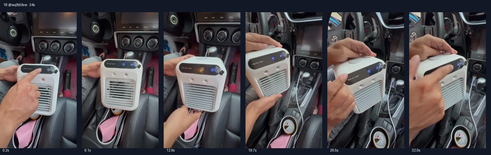

# 18 @wqfb5few · 相同口播的另一车载演示版

原视频：[打开 TikTok](https://www.tiktok.com/@wqfb5few/video/7502454682351078702)

处理状态：已完成

时长：约34秒；口播语言：西班牙语。

[本地视频](../../videos/18_wqfb5few_7502454682351078702.mp4)

## 发布文案原文

Portable Air Conditioner 3-in-

## 发布文案中文释义

便携式空调，三合一……（原发布文案截断于3-in-）。

## 口播中文翻译

你的车没有空调吗？ 我给你带来了解决办法。 就是这台便携式迷你空调， 完全可以充电使用。 看，想带去哪里都可以。你看， 吹出来可真够凉的。 大家看看，怎么样？ 喜欢吗？去橙色购物车，买一台自己的吧。 有了它，以后在车里就不用再挨热了。 你们看看，怎么样？再看， 怎么样，凉得很。 厉害吧，朋友们，亲测推荐！

## 口播原文

¿Tu carro no cuenta con aire acondicionado? Te traigo la solución. Te traigo este mini aire acondicionado portátil totalmente recargable. Mira, te lo puedes llevar a donde tú quieras. Mira y enfría de a madre. Miren qué tal, ¿eh? ¿Les gustó? Vayan al carrito anaranjado y compren el suyo. Mira, ya no van a volver a pasar calor en su auto. Miren, eh, ¿qué tal? Y miren qué hubo. Enfría de a madres. Cabrón eh, ¡calado y recomendado mi gente!

## 大致拆解脚本

时间为大致段落划分，并非逐镜头剪辑点。

| 时间 | 画面动作 | 中文口播要点 | 该段作用 |
|---|---|---|---|
| 00:00–00:03 | 奔驰车内中控位置，机器置于扶手旁。 | 车里没空调的提问与解决方案。 | 明确目标人群。 |
| 00:03–00:09 | 双手拿起并转动机器。 | 便携式小空调，可充电。 | 展示体积和移动性。 |
| 00:09–00:16 | 近拍正面出风口，手试风。 | 哪里都能带，强调凉感。 | 手部体验作为感官证据。 |
| 00:16–00:22 | 机器放回车内，按动面板。 | 喜欢就点橙色购物车，车里不用挨热。 | 较早发出购买引导。 |
| 00:22–00:34 | 继续按键和手试风，最后保留产品全景。 | 重复凉感和亲测推荐。 | 强化同一卖点。 |

## 画面关键文字

无明显额外长标题，主要拍摄机身。

## 记录说明

与第1条口播几乎相同，但车辆内饰、拍摄角度和手部动作不同；不能只按账号判断为独立脚本。

原文保留平台自动识别结果；中文按语境翻译。无法确认的词句已标记。价格、续航、销量、温度、功效及退货条件为原视频表述，未作事实核验。

