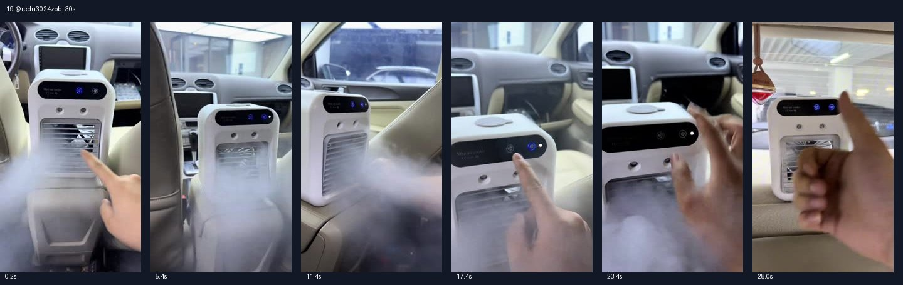

# 19 @redu3024zob · 企鹅话术英文版

原视频：[打开 TikTok](https://www.tiktok.com/@redu3024zob/video/7642733741797920014)

处理状态：已完成

时长：约30秒；口播语言：英语。

[本地视频](../../videos/19_redu3024zob_7642733741797920014.mp4)

## 发布文案原文

Personal Small Evaporative Cooler #SmallAirCooler #PortableCoolingFan #DesktopAirCooler #SummerCooling #HomeMiniFan

## 发布文案中文释义

个人用小型蒸发式冷风机。原话题标签保留。

## 口播中文翻译

你的房间都快要出现企鹅了。 这真的是我在 TikTok Shop 最满意的一次购物。 价格特别实惠，基本上就是一台迷你空调。 但说真的，吹出来特别凉。 给房间、客厅或者办公室送凉风都挺不错。 个头小，但很有劲。控制面板可以调风速， 也能打开或者关闭制冷模式。 只要往顶部加水，就可以用了。 它是无线的，出风口也能灵活调节。 现在正在打折，别错过。 我把链接放在橙色购物车里了。

## 口播原文

Even penguins are going to show up in your room. This is honestly my best purchase from TikTok Shop. It's super affordable and basically a mini air conditioner. But seriously, it gets ice cold. It can cool a room, living room or office really well. It's small but powerful. There's a control panel to adjust fan speed and switch cooling mode on or off. Just add water on top and it's ready. It's wireless and the vent can move freely. It's on sale right now, so don't miss it. I've left it in the orange cart.

## 大致拆解脚本

时间为大致段落划分，并非逐镜头剪辑点。

| 时间 | 画面动作 | 中文口播要点 | 该段作用 |
|---|---|---|---|
| 00:00–00:06 | 车内手指向机器，水雾占据前景。 | 企鹅钩子，TikTok最满意的一次购买。 | 用夸张结果和个人经历开场。 |
| 00:06–00:15 | 不同车内角度的出风口近拍。 | 价格实惠、小而有劲，覆盖房间和办公室。 | 压缩卖点和场景信息。 |
| 00:15–00:22 | 按控制面板，演示模式开关。 | 调节风速，开关制冷模式。 | 与口播同步呈现功能。 |
| 00:22–00:26 | 手在面板和机器顶部附近操作。 | 顶部加水，无线，出风口可调。 | 给出基础用法。 |
| 00:26–00:30 | 室内产品特写，手势推荐。 | 正在优惠，橙色购物车。 | 促销和购买引导。 |

## 画面关键文字

机身Mini air cooler＝迷你冷风机。

## 记录说明

与第6、14、20条结构高度相似，改为英文口播；画面以车内机器为主，末尾切到室内。

原文保留平台自动识别结果；中文按语境翻译。无法确认的词句已标记。价格、续航、销量、温度、功效及退货条件为原视频表述，未作事实核验。

