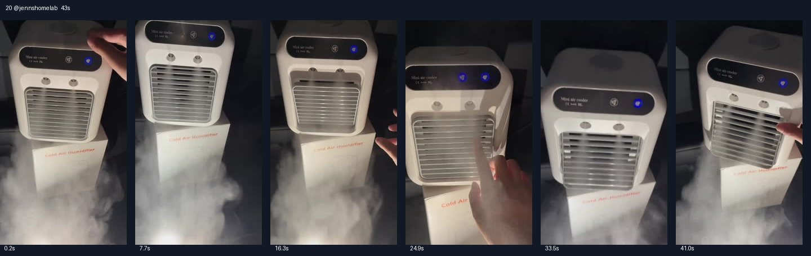

# 20 @jennshomelab · 企鹅话术35美元版本

原视频：[打开 TikTok](https://www.tiktok.com/@jennshomelab/video/7649417099294690591)

处理状态：已完成

时长：约43秒；口播语言：西班牙语。

[本地视频](../../videos/20_jennshomelab_7649417099294690591.mp4)

## 发布文案原文

Gracias a este mini aire acondicionado ya no paso más calor en verano#minicoolers #miniaircooler #coolingfan #minicoolingfan #summervibes

## 发布文案中文释义

有了这台迷你空调，夏天不再挨热。原话题标签保留。

## 口播中文翻译

你的房间都快要出现企鹅了！ 这绝对是我最满意的一次购物。 就在 TikTok Shop 买的， 花了 35 美元，是一台迷你， 空调， 但真的凉得我手都快冻住了。 它能给一个房间， 客厅、办公室带来凉意， 完全没问题。 个头特别小，但很有劲。 它有这个控制面板，可以， 调节， 风扇的速度， 也能选择要不要开制冷模式。 我只需要， 往上面加水，就能用了。 另外，你们看， 它是无线的， 这个出风格栅也能按你的需要调。 现在正在优惠， 抓紧吧，因为我不知道， 这个价格还能持续多久。链接就在橙色购物车里。

## 口播原文

¡Hasta pingüinos van a salir en tu cuarto! Esta es sin duda mi mejor compra. De aquí de tiktok shop me costó treinta y cinco dolaritos y es un mini aire acondicionado, pero de verdad me congela la mano. Puede enfriar un cuarto, una sala, una oficina. Perfectamente superchiquito pero muy potente. Tiene este panel de control donde puedes controlar la velocidad del ventilador, también si lo quieres acondicionado o no. Todo lo que tuve que hacer es ponerle agua aquí arriba y está listo para usarse. Además, chequen, es inalámbrico, esta rejilla se mueve a tu gusto. Está en oferta en este momento, aprovecha porque no sé cuánto tiempo vaya a durar este precio te lo dejo aquí en el carrito naranja

## 大致拆解脚本

时间为大致段落划分，并非逐镜头剪辑点。

| 时间 | 画面动作 | 中文口播要点 | 该段作用 |
|---|---|---|---|
| 00:00–00:09 | 机器放在包装盒上，背景较暗，前方水雾明显。 | 企鹅钩子、满意购物、价格35美元。 | 快速给出结果和价格。 |
| 00:09–00:18 | 手在格栅前感受风，产品始终在中央。 | 小而有劲，房间、客厅、办公室可用。 | 连续强化核心卖点。 |
| 00:18–00:28 | 按键和顶部水箱近景。 | 控制风速与模式，顶部加水即可。 | 说明易用性。 |
| 00:28–00:33 | 手动拨动格栅。 | 无线，出风方向可调。 | 展示可见功能。 |
| 00:33–00:43 | 回到机器全景，最后数秒保留运行画面。 | 当前优惠、价格不知何时结束、橙色购物车。 | 紧迫感和购买入口。 |

## 画面关键文字

机身及包装Cold Air Humidifier＝冷风加湿器。

## 记录说明

本条口播明确说35美元，区别于第6、14条的不到30美元；翻译分别保留。

原文保留平台自动识别结果；中文按语境翻译。无法确认的词句已标记。价格、续航、销量、温度、功效及退货条件为原视频表述，未作事实核验。

