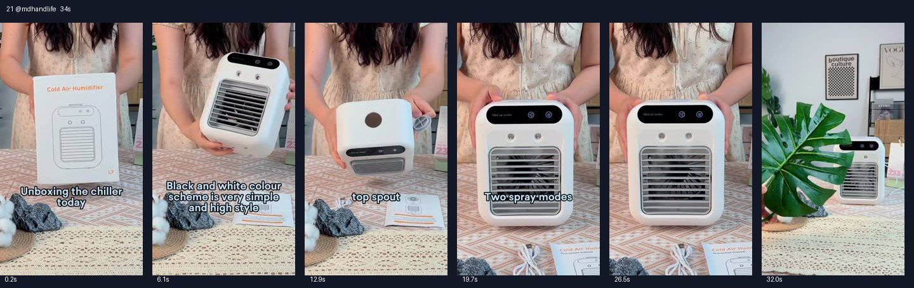

# 21 @mdhandlife · 无口播开箱展示型

原视频：[打开 TikTok](https://www.tiktok.com/@mdhandlife/video/7383347668287884590)

处理状态：已完成（无产品口播）

时长：约34秒；口播语言：无产品口播。

[本地视频](../../videos/21_mdhandlife_7383347668287884590.mp4)

## 发布文案原文

#PortableCooler #StayCool #SummerEssentials #BeatTheHeat #CoolDown #HomeComfort #EnergyEfficient #EcoFriendly #SummerMustHave #AirCooler #CoolingSolutions #StayFresh #ChillVibes #CoolingFan #CoolTech #CoolBreeze #ClimateControl #HeatWave #HomeAppliances #TechGadgets

## 发布文案中文释义

仅话题标签，无正文。

## 口播中文翻译

无产品口播。背景为英文歌曲，未将歌词列为产品字幕。

## 大致拆解脚本

时间为大致段落划分，并非逐镜头剪辑点。

| 时间 | 画面动作 | 中文口播要点 | 该段作用 |
|---|---|---|---|
| 00:00–00:06 | 女子在桌前展示包装并取出机器。 | 无口播，画面文字介绍今天开箱。 | 用完整包装和开箱建立真实感。 |
| 00:06–00:12 | 手持机器转动，展示正面与配件。 | 画面文字介绍黑白配色。 | 展示外观和体积。 |
| 00:12–00:17 | 打开顶部加水口并展示。 | 画面文字说明顶部加水口。 | 把使用方式拍清楚。 |
| 00:17–00:28 | 机器正面，手指按动控制面板。 | 画面文字介绍两种喷雾模式。 | 通过按键和运行展示功能。 |
| 00:28–00:34 | 产品放桌面，与绿植及室内陈设同框。 | 音乐继续，无口播购买口令。 | 用生活化陈列作收尾。 |

## 画面关键文字

Unboxing the chiller today＝今天开箱冷风机；Black and white colour scheme is very simple and high style＝黑白配色简洁有格调；top spout＝顶部加水口；Two spray modes＝两种喷雾模式。

## 记录说明

无产品口播，背景为英文歌曲；不把歌词误当成产品字幕。另列画面关键文字及中文释义。

原文保留平台自动识别结果；中文按语境翻译。无法确认的词句已标记。价格、续航、销量、温度、功效及退货条件为原视频表述，未作事实核验。

