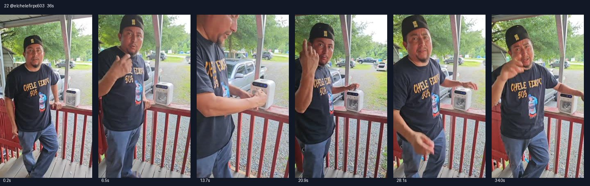

# 22 @elchelefirpo503 · 给猫降温的父子喜剧型

原视频：[打开 TikTok](https://www.tiktok.com/@elchelefirpo503/video/7505168824291888427)

处理状态：已完成

时长：约36秒；口播语言：西班牙语。

[本地视频](../../videos/22_elchelefirpo503_7505168824291888427.mp4)

## 发布文案原文

#viralvideo #comedia 

## 发布文案中文释义

仅话题标签：热门视频、喜剧。

## 口播中文翻译

嘿，爸！怎么了，儿子？你拿的是什么，老爸？ 什么？你， 没看见吗， 我买了， 这台小空调， 给那几只小猫， 就是我养的， 那几只。我的猫热得受不了，你看， 不过它， 不仅仅， 能给猫用，放在小房间里也行。 你说什么呢， 老爸？这么远还吹得出这么凉的风？ 这是空调。 看，这里写着 mini air cooler，送凉风的。 你只要在这里加水，过来看看， 这里可以装不少水。 当然，而且还带充电器。 我会， 把它放， 在橙色购物车里， 就在我名字上面，你想要也可以去看。 别让， 狗狗在接下来的热天里挨热了。[原字幕疑漏否定词] 猫咪也一样。就这样，朋友们。

## 口播原文

Hey, ¡papá! Qué pasó, ¿hijo? Qué es eso que tiene ahí, ¿viejo? ¿Qué? ¿No estás viendo que le compré este airecito para unos gatillos que tengo ahí? Vos tengo unos gatos que están aguantando calor. Y mirá, pero no solo sirven para los gatos, sino que también en un cuarto pequeñito. Estás hablando, viejo, ¿que hasta dónde echa un vergo de aire congelante? Ahí es aire acondicionado. Mira, aquí dice, ve mine, aire congelante, solo tenés que zamparle agua aquí. Ven y ve, aquí lleva bastante agua, claro, y trae a su cargador. Ahí se a dejar en el carrito anaranjado arriba de mi nombre, por si usted también lo quiere. Que los chuchos aguanten calor en esta temporada de calor que viene. Ni los gatos ahí estamos raza

## 大致拆解脚本

时间为大致段落划分，并非逐镜头剪辑点。

| 时间 | 画面动作 | 中文口播要点 | 该段作用 |
|---|---|---|---|
| 00:00–00:06 | 男子站门廊，机器摆在栏杆上，镜头外有人提问。 | 儿子问父亲机器是什么，回答给小猫买的。 | 人物关系加宠物用途引起兴趣。 |
| 00:06–00:12 | 男子指向机器，保持中景。 | 猫热得受不了，除此之外小房间也能用。 | 从宠物场景延伸到人用。 |
| 00:12–00:20 | 靠近机器，用手感受出风。 | 对风量和凉感惊讶，说明产品名称。 | 对话中的体验反应。 |
| 00:20–00:26 | 手指顶部水箱，拍到机器和男子。 | 只需加水，水箱能装水，带充电器。 | 补充使用步骤。 |
| 00:26–00:36 | 人物指向画面下方，轻松聊天收尾。 | 橙色购物车在名字上方，照顾宠物过热天。 | 明确购买入口并回扣开场。 |

## 画面关键文字

没有稳定的大标题，主要为门廊真人与机器。

## 记录说明

原口播末尾有疑似否定词漏识别，中文已标出；画面是门廊上的真人对话，未直接拍到猫。

原文保留平台自动识别结果；中文按语境翻译。无法确认的词句已标记。价格、续航、销量、温度、功效及退货条件为原视频表述，未作事实核验。

