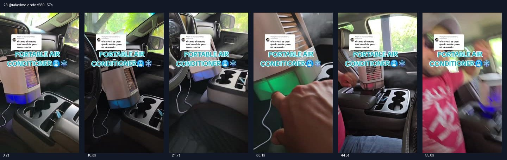

# 23 @rafaelmelendez580 · 房间效果质疑的答疑型

原视频：[打开 TikTok](https://www.tiktok.com/@rafaelmelendez580/video/7498074027848748318)

处理状态：已完成

时长：约57秒；口播语言：西班牙语。

[本地视频](../../videos/23_rafaelmelendez580_7498074027848748318.mp4)

## 发布文案原文

Replying to @mariorio1975 #Portable Air Conditioner 3-in#viral #fyp #MELENDEZ🇲🇽🧱🇺🇸 

## 发布文案中文释义

回复 @mariorio1975：便携式三合一小空调。原话题标签保留。

## 口播中文翻译

来，我们看看。 这位朋友说，给车降温我信， 但给一个房间降温就不信，朋友。 你有一部分说得对， 这样一台便携小空调， 不可能把一整栋房子都吹凉，没错。 但一个房间、一间卧室，是可以送来凉意的。 你看，真不错， 吹出来挺凉， 而且朋友们，我最喜欢的是， 它还能放进你的车里， 有时候孩子们坐在后面热得很。 你看，确实不错，朋友们。 还有我很喜欢的一点，它接的是 USB， 不用 110 伏插座，也不用别的， 直接插到 USB 接口上就行。 看看，真不错。 朋友们， 你可以往这里加点冰， 加点冷水，按你的需要来， 吹出来的风就挺凉， 所以我百分之百推荐。 所以朋友们， 我真的很推荐这台迷你， 便携空调，朋友们。 只需要在下面这里， 把冷水加到相应水位， 这样一来，放车里， 放卧室， 放你想放的地方， 就能感受到比较凉的风。 大家可以看到，朋友们，它吹出来， 真的挺凉。 我把链接放在这里了， 你点一下就能下单， 赶紧吧，朋友们。

## 口播原文

A ver, vamos a ver. Aquí el compita dice el carro sí te creo que lo enfríe, pero no un cuarto amigazo. En parte tiene razón, es imposible que un aire acondicionado portátil de este va a enfriar toda una casa completa no, pero un cuarto, una recámara, este comodita sí se la enfría. Mira, nada más es una chulada, lo avienta bien friito y lo que más me gusta de todo mi raza que lo pueden poner también aquí en su auto, a veces que las criaturitas van allá con un calorón. Miren nada más, es una chulada mi raza y lo que más me gusta también que va conectado al usb, no ocupa 110V, no ocupa nada, simplemente lo conecta a la conexión de usb y listo. Miren, nada más es una chulada. Aquí mi racita. Usted le puede poner hielito, agüita fresca, lo que usted guste y le va aventar el aire acondicionado bien friito, así que 100% recomendado. Así que mi racita, yo les recomiendo 100% este mini aire acondicionado portable mi raza simplemente aquí abajito lo van a poner el nivel de agua fría y con eso mi raza en su auto, en su recámara, donde ustedes gusten, van a disfrutar de unas temperaturas bien, pero bien frías. Como pueden ver, mi raza lo avienta supersuperfrío. Ahí les dejo el enlace mi raza para que le den clic y lo encarguen, pero ya mi raza

## 大致拆解脚本

时间为大致段落划分，并非逐镜头剪辑点。

| 时间 | 画面动作 | 中文口播要点 | 该段作用 |
|---|---|---|---|
| 00:00–00:11 | 车内产品与质疑评论同框。 | 先读质疑，再承认不能吹凉整栋房子。 | 先认可部分观点，降低对立。 |
| 00:11–00:23 | 机器运行近景，拍到车内乘客。 | 解释卧室和车内使用，提到后座孩子热。 | 缩小效果范围并回到具体人群。 |
| 00:23–00:32 | 镜头沿供电线和机器移动。 | USB连接，不需要110伏插座。 | 消除供电顾虑。 |
| 00:32–00:44 | 手指向水箱与出风口。 | 加冰、加冷水，口头推荐。 | 给出操作方法。 |
| 00:44–00:58 | 继续拍机器和人物。 | 说明水位，重复车里和卧室场景，下方链接。 | 重复使用价值并引导下单。 |

## 画面关键文字

评论：车里能凉我信，一个房间就不信；PORTABLE AIR CONDITIONER＝便携式空调。

## 记录说明

画面中至少有两种机器；口播承认不能吹凉整栋房子，但仍宣称可用于小房间，属于原视频说法。

原文保留平台自动识别结果；中文按语境翻译。无法确认的词句已标记。价格、续航、销量、温度、功效及退货条件为原视频表述，未作事实核验。

