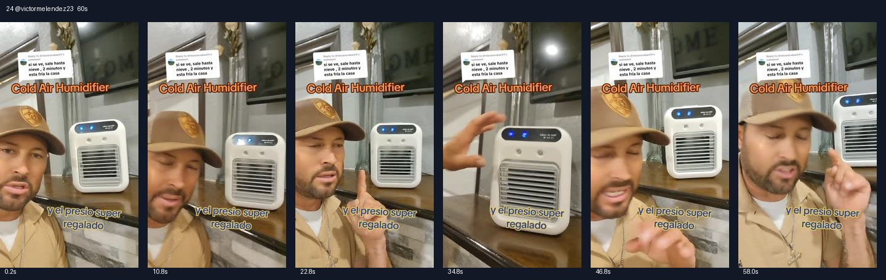

# 24 @victormelendez23 · 回复夸张好评的真人型

原视频：[打开 TikTok](https://www.tiktok.com/@victormelendez23/video/7492677757889989934)

处理状态：已完成

时长：约60秒；口播语言：西班牙语。

[本地视频](../../videos/24_victormelendez23_7492677757889989934.mp4)

## 发布文案原文

Replying to @dimasescobar09 #3 en unu y es recargable#TikTokshop #viral #fyp #Melendez🇲🇽🧱 

## 发布文案中文释义

回复 @dimasescobar09：三合一，而且可以充电。原话题标签保留。

## 口播中文翻译

来，我们， 先读一下这位朋友对这台小空调的评论， 这么小， 又好又便宜。 他说，能看见， 都吹出雪来了，两分钟家里就凉了。那我说， 昨天晚上，说真的， 我把它放在卧室床头。确实， 早上醒来， 鼻子都有点堵了。说实话，因为它吹得挺凉。 你可以把它， 放客厅、卧室、厨房， 放浴室， 甚至放车上，之前我也说了。它确实能送凉风。 这里顶部加水，还能调风速。 看，你看，还有一档。 另外你看，这个可以往上， 往下调，真的挺不错。 没错， 朋友们， 如果想下单， 说真的，我是推荐的，确实不错， 你自己也能看到， 风量挺大。说真的， 当你亲眼看见， 眼前就是真实效果，也就没什么可争的。 所以， 如果想下单， 链接就在这里。 要是它， 不好用， 也不会像现在这样卖得这么多。 说真的，很多人都在买。

## 口播原文

Pues a ver, vamos a leer el comentario aquí mi compita sobre este aire acondicionado pequeñito, pequeño, bueno y barato. Sí se ve, sale hasta nieve 2 minutos y está fría la casa. Pues mire, yo anoche la mera verdad que lo dejé ahí, en mi cuarto, en la cabecera de la cama. Y sí, sí, amaneció poco mormado. La mera neta. ¿Por qué? Porque sí enfría bastante. Este te sirve como para que lo pongas en tu sala, en tu cuarto, en la cocina, en el baño hasta en tu carro, como se los dije. Pero de que enfría, enfría, se le echa agua acá arriba y tiene su velocidad. Mira, chécate ahí, tiene una velocidad más. Además mira y aquí le mueves, mira para arriba, para abajo, la verdad que está supersupergenial, así es mi raza si gustan ordenarlo, la verdad que yo sí lo recomiendo, está superpadrísimo, ustedes pueden ver por ustedes mismos que avienta bastante aire la neta, que cuando uno mira las cosas y es verdad lo que estás mirando, no hay ni qué discutir, así es si gustan ordenarlo el link y si no fueran buenos no se estuvieran vendiendo como se han estado vendiendo. La verdad que mucha gente los está ordenando

## 大致拆解脚本

时间为大致段落划分，并非逐镜头剪辑点。

| 时间 | 画面动作 | 中文口播要点 | 该段作用 |
|---|---|---|---|
| 00:00–00:10 | 戴帽男子和机器同框，顶部保留评论。 | 读出夸张好评，强调小、好、便宜。 | 借评论提供社交认同。 |
| 00:10–00:19 | 真人近景，手指机器。 | 讲昨晚放床头的个人体验。 | 用具体经历支持推荐。 |
| 00:19–00:28 | 展示机器全景。 | 客厅、卧室、厨房、浴室、汽车都能放。 | 多场景延伸。 |
| 00:28–00:38 | 按键切换风速，手动调整格栅。 | 顶部加水，切换档位，调上下方向。 | 可见操作是中段重点。 |
| 00:38–01:00 | 回到真人和出风口同框。 | 自己看效果，个人推荐，提到很多人购买和链接。 | 体验加从众心理作结。 |

## 画面关键文字

评论说像下雪、两分钟房子就凉；Cold Air Humidifier＝冷风加湿器；价格很实惠。

## 记录说明

评论中的两分钟冷却及口播中的身体感受均为创作者或评论者描述；没有温度实测。

原文保留平台自动识别结果；中文按语境翻译。无法确认的词句已标记。价格、续航、销量、温度、功效及退货条件为原视频表述，未作事实核验。

