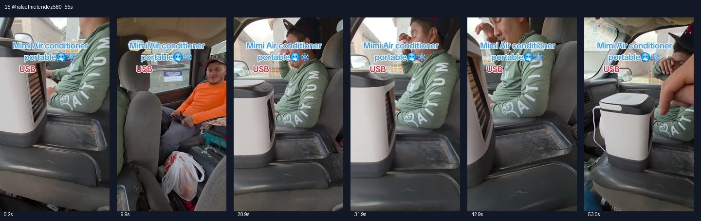

# 25 @rafaelmelendez580 · 朋友买了车载小空调的访谈型

原视频：[打开 TikTok](https://www.tiktok.com/@rafaelmelendez580/video/7498463814623497503)

处理状态：已完成

时长：约55秒；口播语言：西班牙语。

[本地视频](../../videos/25_rafaelmelendez580_7498463814623497503.mp4)

## 发布文案原文

#Portable Air Conditioner #tiktokshop #fyp #viral #MELENDEZ🇲🇽🧱🇺🇸 

## 发布文案中文释义

便携式空调。原话题标签保留。

## 口播中文翻译

哎，Pollito 兄弟， 你可真行，Pollito， 这个便携空调你在哪买的？ TikTok Shop。真的？ 怎么了，Pollito？ 皮卡里面热得很， 可你原来的车载空调之前不是还凑合能用吗？ 不，它很冷， 不，是很热， 已经不制冷了，这台皮卡，不行。 朋友们，Pollito， 你们看看， 他在 TikTok Shop 买的东西， 就是一台便携迷你空调。 现在你们看，吹出来挺凉。 朋友们， 我看到这类小空调， 现在特别火， 大家都买来放车里， 或者放房间。Pollito， 放你卧室怎么样？ 这东西正好用，对吧？对。 不过你要把它带回家， 还是就留在皮卡里？ 就放皮卡里。 哦，留在皮卡里，里面确实很热。 放这里。好，谢谢，Pollito。 这小空调我该给你多少钱？ 首先，朋友们， 百分之百推荐， 往这里加点冷水，就能吹风。 你们看，朋友们， 这台小空调吹出来挺凉。 哎，Pollito， 穿件外套吧，小心着凉！ 哈哈，怎么样，Mauri，怎么样，管用吧？ 推荐吗？ 看这台小空调， 你们知道了，朋友们， 购物车我放在这里了，点一下， 赶紧下单吧，朋友们。

## 口播原文

Eh, pinche, pollito, no te pases de lanza, pollito, ¿dónde compraste este aire acondicionado portátil? En top shop, sí, y eso, pollito, pinche calorón aquí en la troca, pero si el aire de la troca andaba jalando más o menillos, no, está bien frío, está bien caliente, ya no enfría. La pinche troca, no, mi racita, el pinche, pollito, miren, nada más, lo que se compró en tiktok shop es un mini aire acondicionado portátil. Y ahora sí, miren bien friito, pues mi racita, he visto que estos airecitos ahorita son este lo más viral, y toda la gente lo está comprando para sus carros, para sus habitaciones, eh, pollito, y en su cuarto, ¿qué tal? Qué le parece esto apenas para verdad, que sí, sí, pero este se lo va a llevar para la casa o aquí lo va a dejar en la troca, no aquí en la troca, o va a estar aquí para la troca, está bien caliente, ¿aquí no? Pues gracias, pollito, cuánto lo va a deber del airecito, primero, mi racita, 100% recomendado, nada más le ponen aquí agua friita y lo avientan. Miren, si pueden ver mi racita, supersuperfrío ese aire acondicionado, eh, pollito, póngase una pinche chamarra, porque se va a resfriar, ¿eh? Ja, ja, ja, qué tal, mauri, ¿qué tal? Jala, eh, lo recomienda, mire, pinche, airecito acondicionado, pues ya saben mi raza, ahí les dejo el carrito para que le den clic, pero ya mi raza

## 大致拆解脚本

时间为大致段落划分，并非逐镜头剪辑点。

| 时间 | 画面动作 | 中文口播要点 | 该段作用 |
|---|---|---|---|
| 00:00–00:13 | 车内拍绿色衣服的乘客和机器。 | 问哪里买的，解释皮卡太热、旧空调不行。 | 购买渠道和痛点一开始就出现。 |
| 00:13–00:27 | 机器放中控，人物试风聊天。 | 介绍迷你便携空调，提到热销及房间用途。 | 真人体验与流行感结合。 |
| 00:27–00:36 | 镜头在机器和乘客间切换。 | 讨论带回家还是留在车里，决定车上用。 | 通过对话明确使用场景。 |
| 00:36–00:44 | 手指机器顶部和出风口。 | 加冷水就能用，强调凉感。 | 补足操作方法。 |
| 00:44–00:55 | 众人调侃要穿外套，镜头回到机器。 | 问是否推荐、给购物车下单入口。 | 玩笑强化感受并结束购买引导。 |

## 画面关键文字

Mini Air conditioner portable＝迷你便携空调；USB。

## 记录说明

本条使用的机型外观与第1、3条不同；拆解保留实际画面差异，不默认是同一SKU。

原文保留平台自动识别结果；中文按语境翻译。无法确认的词句已标记。价格、续航、销量、温度、功效及退货条件为原视频表述，未作事实核验。

