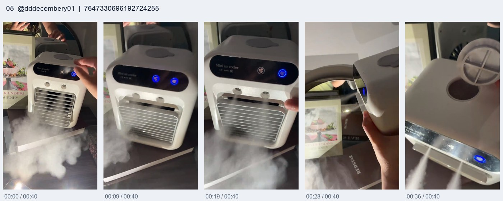
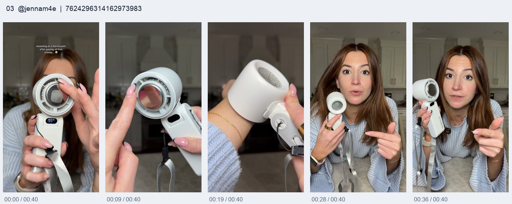
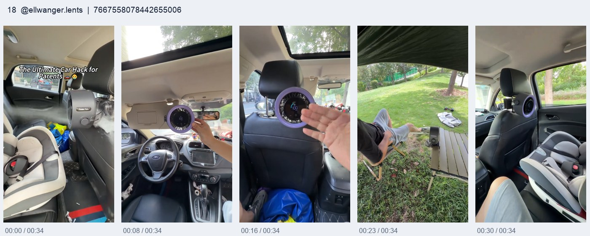
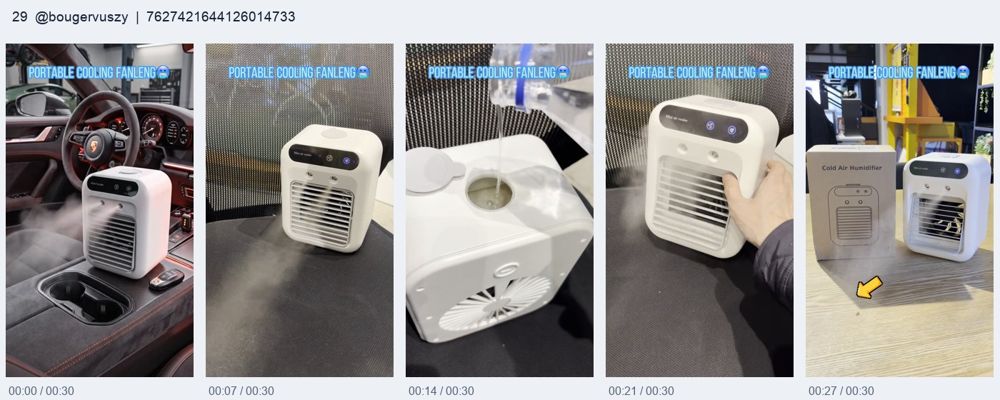
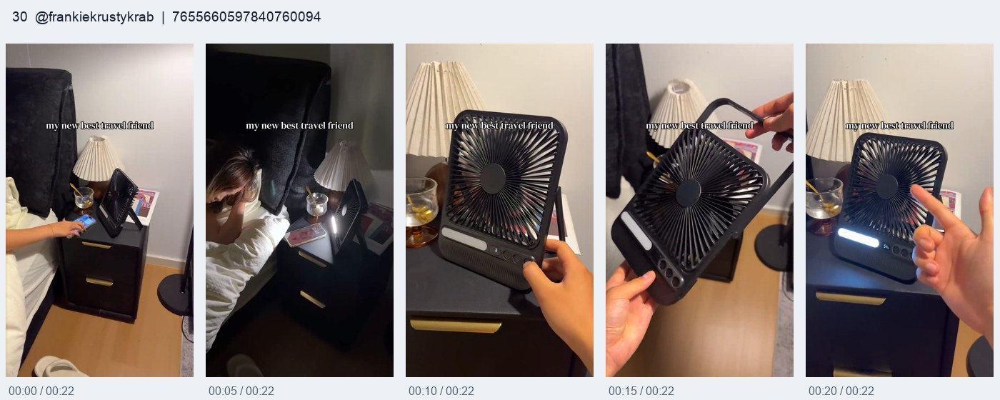
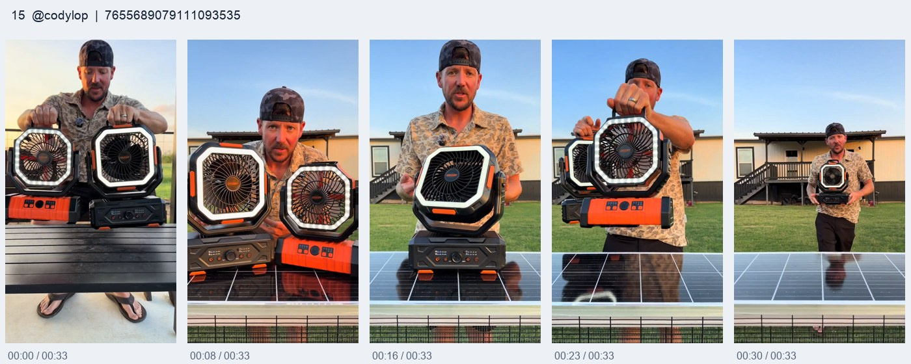

# Tayan 桌面冰雾扇 · 澳大利亚广告测试计划

更新：2026-10-29；市场：Australia；产品：https://tayentech.com/products/tayan-cooling-system-8848

所有主稿包含“mini air conditioner / 迷你小空调”。当前优先复用已确认的大喷雾、悬挂、外国人演示、房车、露营、户外、妈妈及小孩室内/车内素材。小孩室内S12、车内S06独立测试。第2部分有16个方向、每方向3个完整变体，共48条口播；其中13个方向可直接混剪、3个需补镜头，第3部分为64个后续方向。

01 / START HERE
先用现有素材测试，再补拍新方向
先用你反馈留存和出单较好的
大喷雾、悬挂功能
做共同画面底稿，第一句换不同人群口播。现有外国人演示、房车、露营、户外、妈妈、小孩室内/车内与多位置悬挂负责承接；仍缺的专属镜头放到第二块补拍，不让当前测试等新拍摄。
所有脚本的固定记忆点
“personal / portable
mini air conditioner
”＋“
迷你小空调
”。紧接着交代它是cool-mist fan，以本品实际喷雾、悬挂和使用画面承接。
统一画面小字：Personal cooling · Cool-mist fan。英文口播与中文对照保持这个定位。
第一批先剪这3条，再扩到13条
S10三段功能快切
、
S09连续否定反转
、
S01怕热人群
。
复用同一批强喷雾和悬挂镜头，先测三种口播结构。再做小孩室内、小孩车内、户外妈妈、露营、房车等现有场景变体。礼物、新旧款实机对比、真实复购3条仍单列补拍。
当前不等新拍摄：先复用大喷雾、悬挂、演示和已有场景，用新口播测试。根据结果，再决定第二块3条和第3部分哪些专属镜头值得补拍。

## 02 / 16个方向 × 3版完整口播

大喷雾和悬挂是你反馈留存、出单较好的现有镜头，作为P0起点；新稿用现有演示B-roll与场景配新旁白，专属新场景单列P1。

### 现有镜头包

- M01 大喷雾特写：主留存镜头；0–2秒前置，产品亮相和CTA前可换角度回扣

- M02 悬挂功能展示：主留存镜头；先给已挂好的结果，再切悬挂动作

- M03 多位外国人功能演示：解释按键、加水、出雾、送风等可见动作；新旁白配演示B-roll

- M04 车内使用：承接司机、乘车和局部用风需求；用实际车内摆位，不虚构车型和行车条件

- M05 小孩室内：卧室与婴儿同框：专供S12室内亲子脚本；也可裁取产品与卧室环境，服务卧室用风变体

- M06 不同位置悬挂：多位置快切，讲可选择的摆位和用途；适合反转、价格价值与收尾

- M07 房车使用场景：S16房车脚本的人群首镜与场景回扣，接既有喷雾、悬挂和操作演示

- M08 露营使用场景：S05露营脚本直接选现有营地使用镜头，不再要求先补拍帐篷或露营人物

- M09 户外使用场景：承接妈妈户外、露营及房车停靠后的用风场景，以原片实际出现的位置为准

- M10 妈妈与小孩人群镜头：S04妈妈人群开场、S12室内家长场景、S06带娃出行人群；按实际场景分别选段

- M11 小孩车内：亲子出行：专供S06车内小孩脚本；与M05室内小孩素材分开选段、分开测试

### 第一块：P0优先混剪现有素材（13个方向，39版完整口播）

## S10 三段功能快切：大喷雾、能悬挂、不同位置用 [P0 优先混剪]

### S10-A / 大喷雾直入卖点

86英文词，约33–39秒

英文完整口播

Still buying a fan that only blows air? Hang on, look at this. It's a mini air conditioner that gives you a breeze and a fine cooling mist. Fill the tank, switch it on, and look at that spray. And this is the bit people miss: you can hang it up, so it doesn't have to take over your table. It's rechargeable, and there's a remote, so you don't have to keep getting up. Bedroom, caravan, camping trip—take your pick. Want one? The link's below.

中文完整口播

还在买只能吹风的风扇？等一下，看看这个。它是一台迷你小空调，能吹风，还能喷出细细的冷雾。给水箱加水，打开，你看看这喷雾。还有个很多人没注意的地方：它能挂起来，不用一直占着桌子。可以充电，还配了遥控器，不用调一下就起来一趟。卧室、房车、去露营，都能安排。想要的话，链接就在下面。

### S10-B / 先惊讶再连续串卖点

92英文词，约35–42秒

英文完整口播

Okay, how is something this small doing all of that? It's a portable mini air conditioner with semiconductor cooling. You get the fan, you get the mist, and yes, the whole thing can hang up. That's your bedside table back. Charge it before you go and you can use it without a cable trailing across everything. Then you've got the remote right beside you when you want to change the breeze. That's a lot of useful stuff in one little unit. Tap the link and have a look at the current offer.

中文完整口播

等一下，这么小一个东西，怎么还装了这么多功能？这是一台带半导体制冷的便携迷你小空调。能吹风、能喷雾，没错，整台还能挂起来，床头柜的位置都省出来了。出门前充好电，用的时候就不用拖着一根线。想调风，遥控器放手边就行。这么小一台，实用的东西倒是一个没少。点下面的链接，看看现在的活动。

### S10-C / 功能越讲越值

90英文词，约34–41秒

英文完整口播

If you're shopping for a summer fan, don't skip this one. It's a mini air conditioner with a mist setting, so there's more going on here than a bit of airflow. See that? Water in, mist on. Now hang it up and you've got the breeze without losing your table space. Bring it back down when you want to move it somewhere else. Rechargeable battery, remote control, fan and mist in one. That's the sort of thing that actually earns its place at home. Get yours through the link below.

中文完整口播

正在买夏天用的风扇？这台先别划走。它是带喷雾的迷你小空调，不是只有一阵风。看到没？加水，开雾。再把它挂起来，有风吹，还不用占桌面。换个地方用，拿下来带过去就行。充电电池、遥控器、风扇和喷雾，都在这一台里。这种东西，放家里才是真的用得上。想要的，点下面的链接。

剪辑提示（不属于口播）

可复用现有镜头：M01 大喷雾特写、M02 悬挂功能展示、M03 多位外国人功能演示、M06 不同位置悬挂

还需要什么：无需新增实拍；制作新旁白、字幕与CTA字卡即可。按本品现有镜头选段。

素材说明：不要求现有素材里有同机位模式对比或连续长镜头。按实际演示快切，保留正常速度和可见结果。

1. M01大喷雾0–1秒，M02悬挂结果1–2秒，数字1/2/3预告 / 字卡参考：THREE THINGS TO WATCH

2. M01：近景与整机雾流各一段，突出真实结果 / 字卡参考：1 · PERSONAL MINI AIR CONDITIONER

3. M02：悬挂动作和挂好后的运行状态 / 字卡参考：2 · HANGING SETUP

4. M06多位置悬挂快切，穿插M03实际操作 / 字卡参考：3 · DIFFERENT POSITIONS

5. M01/M02各回扣一秒，清晰产品与CTA停留 / 字卡参考：SEE DETAILS & CURRENT AU OFFER

结构参考：https://ctxyytx123-ui.github.io/tayan-video-library/#video-7510219028309265710 https://ctxyytx123-ui.github.io/tayan-video-library/#video-7634482525678652686
<!-- reference-visuals-20261029 -->

**冷风机原始批次 #06 · 桌面水雾和风力演示型**

@ismartfinds · 视频ID：7510219028309265710

[点击定位网页素材 冷风机原始批次 #06](https://ctxyytx123-ui.github.io/tayan-video-library/#video-7510219028309265710)

**冷风机原始批次 #14 · 纸条风力证据型**

@lunaharris76 · 视频ID：7634482525678652686

[点击定位网页素材 冷风机原始批次 #14](https://ctxyytx123-ui.github.io/tayan-video-library/#video-7634482525678652686)

## S09 连续否定反转：别以为迷你小空调只能放桌上 [P0 优先混剪]

### S09-A / 买错的反转

87英文词，约33–40秒

英文完整口播

Buying a mini air conditioner and leaving it on your desk? That's the mistake. This one can hang up. Think it only blows air? Nope, fill the tank and turn on the mist. Think you have to sit beside the controls? There's a remote. And it doesn't have to stay in the bedroom either. It's rechargeable, so you can move it when you move. One little thing, a lot more places to use it. Before you buy another ordinary fan, check this one through the link below.

中文完整口播

买了迷你小空调，还一直放桌上占地方？这才是你犯的错。这台能挂起来。以为它只能吹风？不是，加水，还能喷雾。以为调一下就得凑到机器旁边？它还有遥控器。而且也不必一直留在卧室，充好电，你换地方，它也能跟着换。一台小东西，能用的位置还真不少。买普通风扇之前，先点下面链接看看这台。

### S09-B / 连续否定串卖点

87英文词，约33–40秒

英文完整口播

Small-room people, this mini air conditioner has a few surprises. No, it doesn't have to eat up your bedside table—you can hang it up. No, it isn't just fan mode—there's a mist setting too. And no, you don't have to keep walking over to change it—use the remote. Charge it up and you've got more freedom to put your breeze where you want it. That's why this little one is worth a proper look. Tap the link and see what the offer is today.

中文完整口播

房间小的朋友，这台迷你小空调还有几个你没想到的地方。不是非得占着床头柜，它能挂起来。不是只有风扇模式，它还能喷雾。也不是调一下就要跑过去，遥控器直接按。充好电，想把风安排在哪儿，就多了些选择。所以这么小一台，还真值得多看两眼。点下面链接，看看今天是什么活动。

### S09-C / 认知反差开场

87英文词，约33–40秒

英文完整口播

You thought this was just another little fan? So did everyone who missed the mist. It's a mini air conditioner with a water tank, fan and mist settings, and a rechargeable battery. But here's the clever part: hang it up. You keep the breeze and get your table space back. Then pick up the remote instead of getting out of your chair every five minutes. Bedroom today, caravan on the weekend—much better than leaving it in one corner. Want the details? They're in the link below.

中文完整口播

你以为这又是一台小风扇？没注意到喷雾的人，都会这么想。它是有水箱、有风扇和喷雾模式、还能充电的迷你小空调。但更妙的是，它能挂起来。风照样吹，桌面的位置还给你。想调一下，拿遥控器就行，不用坐一会儿又起来。今天放卧室，周末带房车里，何必只留在一个角落。详情就在下面链接里。

剪辑提示（不属于口播）

可复用现有镜头：M02 悬挂功能展示、M01 大喷雾特写、M04 车内使用、M05 小孩室内：卧室与婴儿同框、M06 不同位置悬挂、M03 多位外国人功能演示

还需要什么：无需新增实拍；制作新旁白、字幕与CTA字卡即可。按本品现有镜头选段。

素材说明：开场用挂好后的结果制造反差。不是虚构买家投诉；不需要补拍新人物、商店比价或开箱。

1. M02：开场先给悬挂运行＋喷雾结果，反差字卡 / 字卡参考：ONLY ON YOUR DESK? THINK AGAIN

2. M02悬挂动作，M03整机功能展示 / 字卡参考：PERSONAL MINI AIR CONDITIONER

3. M01大喷雾接M06多位置连切，转折与切点同步 / 字卡参考：NOT JUST FAN MODE · NOT JUST ONE SPOT

4. M05卧室和M04车内各1–2秒，再回M02 / 字卡参考：BEDROOM · CAR · YOUR SETUP

5. M01＋M02两种强镜头回扣，叠CTA / 字卡参考：CHECK CURRENT PRICE & OPTIONS

结构参考：https://ctxyytx123-ui.github.io/tayan-video-library/#video-7491035630697352494 https://ctxyytx123-ui.github.io/tayan-video-library/#video-7514888112246426911
<!-- reference-visuals-20261029 -->

**露营风扇新款阅读报告 #03 · 商店贵价风扇对比：更便宜却功能更多**

 · 视频ID：7491035630697352494

[点击定位网页素材 露营风扇新款阅读报告 #03](https://ctxyytx123-ui.github.io/tayan-video-library/#video-7491035630697352494)

**冷风机原始批次 #09 · 回复评论并处理质疑型**

@lopeztips · 视频ID：7514888112246426911

[点击定位网页素材 冷风机原始批次 #09](https://ctxyytx123-ui.github.io/tayan-video-library/#video-7514888112246426911)

## S01 怕热人群：大喷雾先抓住，再讲迷你小空调 [P0 优先混剪]

### S01-A / 圈定特别怕热的人

88英文词，约33–40秒

英文完整口播

If you're always the first person asking for the air con, this is for you. It's a portable mini air conditioner for a cool breeze right where you're sitting. Add water, turn on the mist, and let the fan do its thing. You can hang it up instead of squeezing another appliance onto your table, and use the remote when you want to change the setting. It's rechargeable too, so it can move with you. Stop sitting there fanning yourself with a bit of paper. The link's below.

中文完整口播

如果你总是第一个喊开空调的人，这个就是给你看的。它是一台便携迷你小空调，把凉风安排到你坐的位置。加水、开雾，让风扇吹起来。还能挂起来，不用再往桌上硬挤一台机器，想调一下，遥控器直接按。它还可以充电，你换地方，也能带着走。别坐在那里拿张纸给自己扇风了，链接就在下面。

### S01-B / 生活吐槽式

89英文词，约34–41秒

英文完整口播

Everyone else says the room is fine, and you're sitting there sweating. Sound familiar? Have a look at this mini air conditioner. It's small, it blows air, and it has a mist setting for that extra fresh feeling up close. Hang it beside your spot and you've still got room for your drink and your phone. The remote means less getting up, and the rechargeable battery means you're not tied to one socket. This is for the person who always wants a little more breeze. Tap the link below.

中文完整口播

别人都说房间不热，就你一个人在那儿流汗，熟不熟悉？看看这台迷你小空调。小小一台，能吹风，还带喷雾，靠近一点吹起来，风感更清新。挂在自己坐的位置旁边，桌上还放得下水杯和手机。有遥控器，不用反复起身；能充电，也不用一直守着同一个插座。总想多吹一点风的人，点下面链接看看。

### S01-C / 夏天情绪反差

91英文词，约34–42秒

英文完整口播

Some people love summer. The rest of us spend it looking for the nearest fan. Here's a little upgrade for that second group: a mini air conditioner with a cooling mist, a hanging option and a remote. Fill it, switch it on and put the breeze near your own seat. Charge it before heading out, then take it from the bedroom to the caravan or your next outdoor break. It's small enough to fit into your routine without becoming another big appliance to deal with. Grab one through the link below.

中文完整口播

有的人特别爱夏天，还有的人，整个夏天都在找离自己最近的风扇。后面这群人，看看这个小升级：能喷冷雾、能悬挂、还带遥控器的迷你小空调。加好水，打开，把风安排在自己的座位旁边。出门前充好电，从卧室带到房车，或者下次户外休息的时候用。小小一台，日常就能用上，不用再伺候一件大家电。下面链接就能买到。

剪辑提示（不属于口播）

可复用现有镜头：M01 大喷雾特写、M02 悬挂功能展示、M03 多位外国人功能演示、M06 不同位置悬挂

还需要什么：无需新增实拍；制作新旁白、字幕与CTA字卡即可。按本品现有镜头选段。

素材说明：开场直接选你反馈效果好的大喷雾镜头，不等达人完整出场。旁白覆盖演示画面，保留产品原本可见动作。

1. M01：最强大喷雾近景直接开场，人群字卡同步出现 / 字卡参考：ALWAYS FEELING TOO WARM?

2. M01转M03：机身全貌和外国人手指功能的演示 / 字卡参考：PERSONAL MINI AIR CONDITIONER

3. M02：先挂好结果，再接实际悬挂动作，随后切M01出雾 / 字卡参考：HANG IT · SET IT · SWITCH IT ON

4. M06：不同悬挂位置各0.8–1.2秒，不编造未出现的房间 / 字卡参考：MORE WAYS TO PLACE IT

5. M01：换角度的大喷雾＋清晰整机定格，叠CTA / 字卡参考：SEE THE CURRENT AU OFFER

结构参考：https://ctxyytx123-ui.github.io/tayan-video-library/#video-7647330696192724255 https://ctxyytx123-ui.github.io/tayan-video-library/#video-7624296314162973983
<!-- reference-visuals-20261029 -->

**便携风扇35条原始批次 #05 · 大雾视觉的桌面冷风机**

@dddecembery01 · 视频ID：7647330696192724255

[点击定位网页素材 便携风扇35条原始批次 #05](https://ctxyytx123-ui.github.io/tayan-video-library/#video-7647330696192724255)

**便携风扇35条原始批次 #03 · 从冷感面板讲到旅行体验**

@jennam4e · 视频ID：7624296314162973983

[点击定位网页素材 便携风扇35条原始批次 #03](https://ctxyytx123-ui.github.io/tayan-video-library/#video-7624296314162973983)

## S12 小孩人群·室内：妈妈和孩子的卧室场景 [P0 优先混剪]

### S12-A / 室内带娃妈妈直给

88英文词，约33–40秒

英文完整口播

Mums with little ones at home, you already have enough stuff taking over the bedroom. This mini air conditioner can hang up, so here's one thing that doesn't need your bedside table. Add water and you've got fan and mist settings, with a remote so you're not getting up every time you want a different breeze. It's rechargeable too, which makes moving it from one room to another much easier. A little breeze for your own corner while the family takes over everything else. Tap the link below.

中文完整口播

在家带小孩的妈妈们，卧室里东西已经够多了吧？这台迷你小空调能挂起来，至少这一件，不用再抢你的床头柜。加上水，可以吹风，也可以开喷雾，还有遥控器，想换个风感，不用每次都起来。它还能充电，从一个房间拿到另一个房间也方便。全家人的东西已经铺得到处都是了，给自己的角落留一阵风。链接就在下面。

### S12-B / 卧室生活痛点

90英文词，约34–41秒

英文完整口播

Mums, bedtime is enough of a mission without the bedroom feeling stuffy as well. Look at this little mini air conditioner. You get a fan, a fine mist and a hanging setup, all in one compact unit. Keep the controls beside you with the remote, and choose the breeze you want without doing another lap of the room. Charge it up when you need to, move it when you change rooms, and keep that bedside space for all the things you actually need there. Want one? Tap the link below.

中文完整口播

妈妈们，晚上照顾小孩已经够忙了，卧室里还闷闷的，更烦。看看这个小小的迷你小空调。风扇、细雾、悬挂，一台都带了。遥控器放手边，想调成什么风，不用又在房间里来回跑。需要时充好电，换房间还能拿着走，床头的位置就留给你真正要放的东西。想给家里安排一台，点下面的链接。

### S12-C / 宝宝拟人开场

90英文词，约34–41秒

英文完整口播

Mums, if your little one could make a shopping list, a less stuffy bedroom might be on it. Here's something for your room setup: a portable mini air conditioner. It has a water tank for the mist, adjustable airflow and a remote, and you can hang it up instead of finding space on another crowded table. It's rechargeable, so it doesn't have to live in the same room forever. Simple to move, easy to reach with the remote, and useful for your own breeze at home. The link's right below.

中文完整口播

妈妈们，要是小孩也会列购物清单，说不定会先写上：卧室别这么闷。给房间看看这个，便携迷你小空调。有装水喷雾的水箱，能调送风，还配遥控器。挂起来就行，不用再从已经挤满的桌上找地方。它还能充电，不必一直留在同一个房间。拿着走方便，遥控器也就在手边，在家想给自己吹点风，正好用上。链接就在下面。

剪辑提示（不属于口播）

可复用现有镜头：M05 小孩室内：卧室与婴儿同框、M10 妈妈与小孩人群镜头、M01 大喷雾特写、M02 悬挂功能展示、M03 多位外国人功能演示、M06 不同位置悬挂

还需要什么：无需新增实拍；按已确认的现有素材选段，制作新口播、字幕和CTA即可。

素材说明：本条选M05室内卧室/婴儿同框和M10室内家长镜头；不夹入车内画面。旁白讲家庭的用风需求，不新增助眠或防暑效果承诺。

1. M05室内小孩/卧室环境，接M01大喷雾，字卡标室内亲子 / 字卡参考：MUMS & LITTLE ONES · AT HOME

2. M05室内实际产品位置，M01出雾亮相 / 字卡参考：PERSONAL MINI AIR CONDITIONER

3. M05卧室位置＋M02相应悬挂结果，M01补充喷雾细节 / 字卡参考：BEDROOM · MIST · POSITION

4. M03操作演示＋M06室内位置，选室内素材，不放车内镜头 / 字卡参考：CHOOSE YOUR ROOM SETUP

5. M05室内亲子/卧室回扣，M01喷雾收尾CTA / 字卡参考：SEE CURRENT AU OPTIONS

结构参考：https://ctxyytx123-ui.github.io/tayan-video-library/#video-7667558078442655006 https://ctxyytx123-ui.github.io/tayan-video-library/#video-7640670991286324493
<!-- reference-visuals-20261029 -->

**便携风扇35条原始批次 #18 · 从宝宝视角讲后排热**

@ellwanger.lents · 视频ID：7667558078442655006

[点击定位网页素材 便携风扇35条原始批次 #18](https://ctxyytx123-ui.github.io/tayan-video-library/#video-7667558078442655006)

**露营风扇新款阅读报告 #20 · 带娃去公园：给妈妈准备一台**

 · 视频ID：7640670991286324493

[点击定位网页素材 露营风扇新款阅读报告 #20](https://ctxyytx123-ui.github.io/tayan-video-library/#video-7640670991286324493)

## S06 小孩人群·车内：妈妈和孩子出行的用风场景 [P0 优先混剪]

### S06-A / 车内妈妈人群

88英文词，约33–40秒

英文完整口播

Mums with little ones in the back seat, this one's for your summer trip list. It's a portable mini air conditioner, so you can bring a fan and a fine mist along in one little unit. It's rechargeable, it has a remote, and the hanging option gives you another way to place it. Have a look at the car setup here, then pick the position that works with your own space. Pack the drinks, pack the snacks, and remember a breeze for yourself too. Tap the link below.

中文完整口播

家里有小孩坐后排的妈妈们，这个可以加进夏天出行清单。它是一台便携迷你小空调，风扇和细细的喷雾，一台就能一起带上。能充电，有遥控器，还能悬挂，多一种放置方式。看看这里的车内用法，再对照自己车里的空间选位置。饮料、零食都带好了，别忘了也给自己准备一阵风。链接就在下面。

### S06-B / 前后排反差

85英文词，约32–39秒

英文完整口播

Parents, ever noticed the front seat catches the breeze while the back feels stuffy? Here's a little mini air conditioner to have a look at. It's rechargeable and has both fan and mist settings, so you can bring your own airflow closer to the spot you want. There's a remote, and you can hang it up too. Bring it back inside after the trip and you've got a breeze for your own chair at home. Getting ready for the next family trip? The link's below.

中文完整口播

带小孩出门的家长们，有没有发现，前排能吹到风，后面却觉得闷？看看这个小小的迷你小空调。能充电，有风扇和喷雾模式，可以把自己要的风安排得更近一点。遥控器就在手边，还能挂起来。出行结束，带回家，自己坐的位置也能有风吹。准备下一趟全家出行？链接就在下面。

### S06-C / 出行清单切入

88英文词，约33–40秒

英文完整口播

Parents packing half the house for a trip with the kids, one more thing: your own breeze. This mini air conditioner puts a fan, a mist setting and a rechargeable battery into one small unit. You can take it along, use the remote without reaching over to the controls, and hang it up when you want some table space back. It can come back indoors with you after the trip as well. Something useful for the journey and for home. Check the current offer through the link below.

中文完整口播

带小孩出门、恨不得把半个家都装上的家长们，再想起一样：自己的风。这台迷你小空调，把风扇、喷雾和充电电池都装进小小一台里。能一起带出门，想调一下，用遥控器，不用伸手去够机器；想给桌面空点位置，还能挂起来。出行结束，也能带回家继续用。路上用得着，家里也放得上。现在的活动，点下面链接看看。

剪辑提示（不属于口播）

可复用现有镜头：M11 小孩车内：亲子出行、M04 车内使用、M10 妈妈与小孩人群镜头、M01 大喷雾特写、M03 多位外国人功能演示、M02 悬挂功能展示

还需要什么：无需新增实拍；按已确认的现有素材选段，制作新口播、字幕和CTA即可。

素材说明：本条选M11车内小孩/亲子和M04车内使用，产品位置以原片为准；不插入卧室画面，不承诺整车空调或小孩健康效果。

1. M11车内小孩/亲子镜头，接M04产品运行，插M01雾流抓眼 / 字卡参考：PARENTS WITH KIDS · IN THE CAR

2. M04车内本品与周边位置同框，亮出定位 / 字卡参考：PORTABLE MINI AIR CONDITIONER

3. M04实际摆位，M01/M03功能演示；不改造原片固定方式 / 字卡参考：SEE POSITION, MIST & CONTROLS

4. M02产品悬挂功能短镜头，回M11/M04车内，避免卧室场景 / 字卡参考：FAMILY CAR-TRIP SETUP

5. M11/M04车内亲子回扣，接清晰整机与CTA / 字卡参考：CHECK SIZE, OPTIONS & PRICE

结构参考：https://ctxyytx123-ui.github.io/tayan-video-library/#video-7498913909399735598 https://ctxyytx123-ui.github.io/tayan-video-library/#video-7627421644126014733
<!-- reference-visuals-20261029 -->

**冷风机原始批次 #01 · 车里没空调的直接解决型**

@royer.campos8 · 视频ID：7498913909399735598

[点击定位网页素材 冷风机原始批次 #01](https://ctxyytx123-ui.github.io/tayan-video-library/#video-7498913909399735598)

**便携风扇35条原始批次 #29 · 桌面冷风机在车内与阳台切换**

@bougervuszy · 视频ID：7627421644126014733

[点击定位网页素材 便携风扇35条原始批次 #29](https://ctxyytx123-ui.github.io/tayan-video-library/#video-7627421644126014733)

## S04 妈妈人群·户外：带娃出门，也给自己备风 [P0 优先混剪]

### S04-A / 妈妈用品清单反转

84英文词，约32–39秒

英文完整口播

Mums, you've packed the drinks, the snacks and the sunscreen. What did you pack for yourself? This portable mini air conditioner is a good place to start. Charge it before you leave, add water for the mist, and give your own seat a breeze while everyone's busy doing their thing. It can hang up, and there's a remote, so you don't have to keep jumping up to change the setting. You remembered everything for the kids. Don't forget yourself this time. The link's below.

中文完整口播

妈妈们，饮料带了、零食带了、防晒也带了，那给自己带了什么？这台便携迷你小空调，可以先安排上。出门前充好电，加水开雾，大家忙着各玩各的，也给自己坐的位置吹点风。能挂起来，还有遥控器，不用为了调一下就反复站起来。小孩要用的，你一样没忘，这次别把自己忘了。链接就在下面。

### S04-B / 露营产品换人群

87英文词，约33–40秒

英文完整口播

Mums, you don't have to go camping to get use out of a mini air conditioner like this. Taking the kids out, sitting in the shade, waiting around while they play—that's when a little breeze comes in handy. This one's rechargeable, has fan and mist settings, and can hang up to keep the table clearer. The remote is the best bit when you've finally sat down and don't fancy getting up again. Bring something for yourself on the next outing. Get yours through the link below.

中文完整口播

妈妈们，买这种迷你小空调，真不一定非得去露营才用得上。带小孩出门、坐在阴凉处、等他们在旁边玩，这种时候，自己有点风吹就很舒服。这台能充电，能吹风、能开雾，还能挂起来，桌上少占一点地方。好不容易坐下，不想又站起来？遥控器就是这时候用的。下次出门，也给自己带一样。下面链接就能买到。

### S04-C / 圈定总照顾别人的妈妈

88英文词，约33–40秒

英文完整口播

If you're the mum making sure everyone else is comfortable on a hot day, have a look at this. It's a mini air conditioner you can take along for your own spot. Add water, turn on the fan and mist, and hang it up if that suits the space. Rechargeable, compact, with a remote right beside you. Nothing complicated—just a breeze you don't have to share with the entire picnic table. Next time you're packing for the family, leave room for yourself too. Tap the link below.

中文完整口播

热天出门，总在照顾别人舒不舒服的妈妈，看看这个。它是一台能一起带出去的迷你小空调，给自己坐的位置用。加水、开风、开雾，位置合适，还能挂起来。能充电，小小一台，遥控器放手边。没什么复杂的，就是给自己准备一阵风，不用整张野餐桌都来抢。下次给全家收东西，也给自己留点位置。链接就在下面。

剪辑提示（不属于口播）

可复用现有镜头：M10 妈妈与小孩人群镜头、M09 户外使用场景、M01 大喷雾特写、M02 悬挂功能展示、M03 多位外国人功能演示、M06 不同位置悬挂

还需要什么：无需新增实拍；按已确认的现有素材选段，制作新口播、字幕和CTA即可。

素材说明：妈妈与户外镜头已确认有，直接混剪；不再要求补球场、板球服、运动日或观赛包。不同人物的镜头按场景说明使用，不编成同一位妈妈的经历。

1. M10妈妈/小孩人群镜头接M09户外使用，0–2秒插M01强喷雾 / 字卡参考：MUMS OUT WITH THE KIDS

2. M01大喷雾整机，接M03外国人功能演示 / 字卡参考：PERSONAL MINI AIR CONDITIONER

3. M01/M03/M02依口播选现有动作，不重拍功能 / 字卡参考：MIST · CONTROLS · HANGING

4. M09实际户外位置，M10家长镜头回扣，按现有原片选段 / 字卡参考：A BREEZE FOR YOUR OWN SPOT

5. M09户外场景回扣，再用M01/M02强结果镜头叠CTA / 字卡参考：SEE CURRENT AU OPTIONS

结构参考：https://ctxyytx123-ui.github.io/tayan-video-library/#video-7370832127631314218 https://ctxyytx123-ui.github.io/tayan-video-library/#video-7494457199188512042
<!-- reference-visuals-20261029 -->

**露营风扇老款原批次 #03 · 陪孩子打比赛的妈妈推荐**

@octavia.lorraine · 视频ID：7370832127631314218

[点击定位网页素材 露营风扇老款原批次 #03](https://ctxyytx123-ui.github.io/tayan-video-library/#video-7370832127631314218)

**露营风扇新款阅读报告 #01 · 陪孩子看球的妈妈：一台解决吹风和手机充电**

 · 视频ID：7494457199188512042

[点击定位网页素材 露营风扇新款阅读报告 #01](https://ctxyytx123-ui.github.io/tayan-video-library/#video-7494457199188512042)

## S05 露营与户外：现有营地画面直接混剪 [P0 优先混剪]

### S05-A / 露营热场景

88英文词，约33–40秒

英文完整口播

Campers, you packed the tent, the chairs and the food. Then you sit down and there's not a breath of air. This is what the mini air conditioner is for. It's rechargeable, it blows a breeze, and you can add water for the mist. There's a hanging option as well, so it doesn't have to compete with your dinner for table space. Charge it before the trip, bring it along and keep the remote by your chair. One more useful thing for your camp list. The link's below.

中文完整口播

去露营的朋友，帐篷带了、椅子带了、吃的也带了，结果坐下来，一点风都没有。迷你小空调，就是这种时候用的。可以充电，能吹风，加水还能喷雾。也能挂起来，不用跟你的晚饭抢桌子上的位置。出发前充好电，一起带上，遥控器往椅子边一放。露营清单里，又多一样真能用上的。链接就在下面。

### S05-B / 不用拖线的便利

89英文词，约34–41秒

英文完整口播

Camping people, stop planning your entire seat around the nearest socket. Charge this portable mini air conditioner before you leave and use it on battery when you want your own breeze. Fan and mist in one, plus a hanging setup to help keep the table free. And yes, there's a remote, because once you've finally sat down, nobody wants to get straight back up. Use it at camp, bring it home, keep it in the bedroom. That's a much better use of a little gadget. Tap the link below.

中文完整口播

露营的朋友，别为了找插座，连坐哪儿都得跟着安排。出发前把这台便携迷你小空调充好电，想给自己吹点风，就用电池运行。风扇、喷雾在一台里，还能悬挂，桌面也能省出来。没错，遥控器也有，毕竟好不容易坐下，谁愿意马上又起来。露营用完带回家，卧室里继续用，小东西就该这么用得上。链接就在下面。

### S05-C / 小装备反差

92英文词，约35–42秒

英文完整口播

Summer campers, this little thing deserves more attention than its size suggests. It's a mini air conditioner with a water tank for the mist, adjustable airflow and a rechargeable battery. You can hang it up or keep it at a suitable spot near your chair. Then use the remote instead of leaning over every time you want a different setting. No giant fan to make room for on the camp table. Just your own little breeze, ready to move when you do. Add it to your next trip through the link below.

中文完整口播

夏天露营的朋友，别因为它小就没注意到。它是一台带喷雾水箱、能调送风、还能充电的迷你小空调。可以挂起来，也能放在椅子旁边合适的位置。想调一下，用遥控器就行，不用每次都探着身子去按。露营桌上，也不用再专门给一台大风扇腾地方。自己的小风，换位置还能一起带过去。下次出行想带上，点下面的链接。

剪辑提示（不属于口播）

可复用现有镜头：M08 露营使用场景、M09 户外使用场景、M01 大喷雾特写、M02 悬挂功能展示、M03 多位外国人功能演示、M06 不同位置悬挂

还需要什么：无需新增实拍；按已确认的现有素材选段，制作新口播、字幕和CTA即可。

素材说明：露营与户外素材已确认有，直接选营地首尾镜头。没有出现的帐篷、露营人物或安装点不写成必需画面；通用功能用已有大喷雾和悬挂。

1. M08露营使用场景开场，接M01大喷雾近景 / 字卡参考：CAMPERS · YOUR OWN BREEZE

2. M08本品与营地环境同框，M03整机演示承接 / 字卡参考：PORTABLE MINI AIR CONDITIONER

3. M03操作、M01喷雾、M02悬挂实际动作依次快切 / 字卡参考：AIRFLOW · MIST · HANGING

4. M08露营与M09户外使用交替，M06补充实际位置 / 字卡参考：CAMPING + OUTDOOR SETUPS

5. M08营地回扣，最后M01喷雾＋产品CTA / 字卡参考：SEE VERSION & AU PRICE

结构参考：https://ctxyytx123-ui.github.io/tayan-video-library/#video-7640509042481188109 https://ctxyytx123-ui.github.io/tayan-video-library/#video-7632275264143232287
<!-- reference-visuals-20261029 -->

**露营风扇老款原批次 #06 · 露营不再拖延长线**

@thebenderfam24 · 视频ID：7640509042481188109

[点击定位网页素材 露营风扇老款原批次 #06](https://ctxyytx123-ui.github.io/tayan-video-library/#video-7640509042481188109)

**露营风扇新款阅读报告 #06 · 品牌演示：露营风扇的多功能快切**

 · 视频ID：7632275264143232287

[点击定位网页素材 露营风扇新款阅读报告 #06](https://ctxyytx123-ui.github.io/tayan-video-library/#video-7632275264143232287)

## S16 房车人群：常坐的位置也安排一阵风 [P0 优先混剪]

### S16-A / 房车座位痛点

85英文词，约32–39秒

英文完整口播

Caravan people, there's always one seat that never seems to catch a breeze, isn't there? Here's a portable mini air conditioner for your own little corner. Fill the tank for the mist, pick your fan setting and keep the remote close. The hanging option is handy when the bench is already full, and the rechargeable battery gives you more freedom to move it. Use it in the van, then bring it along for your outdoor break. Getting ready for the next trip? The link's below.

中文完整口播

房车旅行的朋友，是不是总有一个位置，怎么都吹不到风？给自己的小角落看看这台便携迷你小空调。水箱加水开雾，选好风，遥控器放手边。台面上已经摆满东西，悬挂这个功能就用得上了；还能充电，换位置更方便。在房车里用，户外休息时也能带出去。正在准备下一趟旅行？链接就在下面。

### S16-B / 房车空间不够

90英文词，约34–41秒

英文完整口播

Caravan owners, you've made every bit of space count. Why let another big fan take over the bench? This mini air conditioner can hang up, and it has a mist setting as well as the fan. Charge it, put it at your own spot and use the remote when you want to change the breeze. Small unit, less clutter, more choice about where it goes. And when you're back home, it can go in the bedroom instead of sitting with the camping gear. Have a look through the link below.

中文完整口播

房车的朋友，每一点空间都算着用，何必再让一台大风扇占满台面？这台迷你小空调能挂起来，除了吹风，还能开喷雾。充好电，安排在自己的位置，想调风，拿遥控器按。小小一台，少占点地方，能放的位置也多点。回到家，还能放卧室里继续用，不用跟露营装备一起闲着。想看，点下面的链接。

### S16-C / 下次房车出行清单

88英文词，约33–40秒

英文完整口播

Got a caravan trip coming up? Put this little mini air conditioner on your list before the bags take over. It gives you fan and mist settings, a rechargeable battery and a remote. But the hanging setup is the clever bit when you're trying to keep the bench clear. Your seat in the van, a shaded break outside, then back home to the bedroom—there are plenty of reasons to keep it handy. Pick one up before your next trip. The current offer is in the link below.

中文完整口播

最近要坐房车出去？行李还没塞满之前，把这台迷你小空调也加进清单。能吹风、能喷雾，有充电电池，还有遥控器。但想给台面少放点东西的时候，能悬挂这个功能才是真方便。房车里自己的座位、户外阴凉处休息、回家再放卧室，能用上的时候还真不少。下次旅行之前安排好，现在的活动就在下面链接里。

剪辑提示（不属于口播）

可复用现有镜头：M07 房车使用场景、M09 户外使用场景、M01 大喷雾特写、M02 悬挂功能展示、M03 多位外国人功能演示、M06 不同位置悬挂

还需要什么：无需新增实拍；按已确认的现有素材选段，制作新口播、字幕和CTA即可。

素材说明：房车素材已确认有，直接使用真实房车环境与本品摆位。车库方向留在第3部分G4后续选题；本条不再要求补车库、工具或修车人物。

1. M07房车使用镜头先入，插M01大喷雾作抓眼结果 / 字卡参考：CARAVAN TRAVELLERS

2. M07房车里的实际产品位置，接M01整机出雾 / 字卡参考：PORTABLE MINI AIR CONDITIONER

3. M07实际摆位，M03功能演示与M01出雾相接 / 字卡参考：SEE THE ACTUAL CARAVAN SETUP

4. M02/M06真实悬挂，接M09户外场景；不暗示原片没有的安装 / 字卡参考：HANGING + OUTDOOR OPTIONS

5. M07房车场景回扣，接M01/M02与CTA / 字卡参考：CHECK SIZE, OPTIONS & PRICE

结构参考：https://ctxyytx123-ui.github.io/tayan-video-library/#video-7640509042481188109 https://ctxyytx123-ui.github.io/tayan-video-library/#video-7514334097951739182
<!-- reference-visuals-20261029 -->

**露营风扇老款原批次 #06 · 露营不再拖延长线**

@thebenderfam24 · 视频ID：7640509042481188109

[点击定位网页素材 露营风扇老款原批次 #06](https://ctxyytx123-ui.github.io/tayan-video-library/#video-7640509042481188109)

**露营风扇老款原批次 #19 · 露营场景串联与父亲节礼物**

@ogery.mart · 视频ID：7514334097951739182

[点击定位网页素材 露营风扇老款原批次 #19](https://ctxyytx123-ui.github.io/tayan-video-library/#video-7514334097951739182)

## S02 租房与省空间：不用给自己再添一台大设备 [P0 优先混剪]

### S02-A / 租房小空间

88英文词，约33–40秒

英文完整口播

Renters, no room for another massive fan? This mini air conditioner can hang up. That's the bit that makes sense in a small bedroom. Fill the tank, turn on the fan and mist, and you've got your own breeze without giving up the entire bedside table. It's rechargeable, so you can move it when you change seats, and the remote means you don't have to keep walking over to it. A small room doesn't need more clutter. It needs useful things. Check this one through the link below.

中文完整口播

租房的朋友，没地方再放一台大风扇了？这台迷你小空调能挂起来。卧室小，这个功能才是真能用上。水箱加水，打开风扇和喷雾，自己有风吹，也不用把整个床头柜都让出来。能充电，换个地方坐，也能带过去；有遥控器，不用调一下就跑过去一趟。小房间不缺东西，缺的是真能用上的。下面链接看看这台。

### S02-B / 不想再添大家电

85英文词，约32–39秒

英文完整口播

Renters, before you drag another huge appliance into the bedroom, look at this little mini air conditioner. Fan, mist and a hanging option in one compact unit. Add water when you want the mist, use the remote from your chair, and keep the table space for your own stuff. Charge it up and it can move with you instead of claiming a permanent corner of the room. That's a lot easier to fit into a small place. Want one for summer? Tap the link below.

中文完整口播

租房的朋友，把另一台大家电搬进卧室之前，先看看这台迷你小空调。风扇、喷雾、悬挂，都在小小一台里。想开雾就加水，坐着用遥控器调，桌上的位置留给自己的东西。充好电，还能跟着你换地方，不用让它一直霸着房间一个角落。住的地方小，这种反倒更好安排。夏天想要一台，点下面的链接。

### S02-C / 固定一个热角落

87英文词，约33–40秒

英文完整口播

Renters, everyone gets the breezy part of the house and you get the stuffy bedroom? Here's something for your corner: a portable mini air conditioner. It has a mist setting for a fresh breeze up close, a rechargeable battery, and a remote so the controls can stay right beside you. Hang it up and you don't even have to clear another spot on the table. Keep your own little breeze where you're actually sitting. If that sounds like your room, have a look at the link below.

中文完整口播

租房的朋友，别人都住在有风的地方，偏偏你的卧室最闷？给自己的角落看看这台便携迷你小空调。带喷雾，靠近自己吹一点清新的风；能充电，还配遥控器，坐着就能调。挂起来，桌上也不用再专门清出一个位置。自己坐在哪儿，就给自己安排一点风。如果说的就是你那个房间，点下面链接看看。

剪辑提示（不属于口播）

可复用现有镜头：M02 悬挂功能展示、M06 不同位置悬挂、M01 大喷雾特写、M05 小孩室内：卧室与婴儿同框、M03 多位外国人功能演示

还需要什么：无需新增实拍；制作新旁白、字幕与CTA字卡即可。按本品现有镜头选段。

素材说明：不需要补拍账单、房东或租房人物。用悬挂结果与现有卧室镜头承接租房口播；只讲画面支持的安装方式。

1. M02：挂好的机器＋明显出雾，字卡圈定租房人群 / 字卡参考：RENTERS · SAVE YOUR SPACE

2. M03机身全貌接M02实际悬挂动作 / 字卡参考：PERSONAL MINI AIR CONDITIONER

3. M06不同位置悬挂快切，再切M01大喷雾 / 字卡参考：LESS TABLETOP CLUTTER

4. M05卧室全景裁出产品与环境，再接M06另一处位置 / 字卡参考：FIND YOUR OWN SPOT

5. M01＋M02最强结果镜头回扣，叠CTA / 字卡参考：CHECK SIZE & CURRENT PRICE

结构参考：https://ctxyytx123-ui.github.io/tayan-video-library/#video-7492282849702284590
<!-- reference-visuals-20261029 -->

**冷风机原始批次 #03 · 真人室内讲解型**

@victormelendez23 · 视频ID：7492282849702284590

[点击定位网页素材 冷风机原始批次 #03](https://ctxyytx123-ui.github.io/tayan-video-library/#video-7492282849702284590)

## S03 卧室习惯：不吹风扇就不自在的人 [P0 优先混剪]

### S03-A / 圈定离不开风扇的人

91英文词，约34–42秒

英文完整口播

If you're one of those people who can't get comfortable without a fan on, this is for you. It's a mini air conditioner with fan and mist settings, so you can pick the breeze you want beside your own spot. Hang it up and keep the bedside table for your drink, charger and everything else. The remote is right there when you want to change it, and it's rechargeable when you want to move it. Your usual fan habit, with a few more useful bits. Get yours through the link below.

中文完整口播

如果你就是那种不开风扇就不自在的人，这个就是给你看的。它是有风扇和喷雾模式的迷你小空调，自己坐的位置旁边，想吹什么风就调什么。挂起来，床头柜就留给水杯、充电器和其他东西。想调一下，遥控器就在手边；想换个地方，还能充电带着走。还是你那个离不开风扇的习惯，只是多了几个更方便的功能。链接就在下面。

### S03-B / 懒得起身调风

86英文词，约33–39秒

英文完整口播

Already comfortable in bed, then the fan needs changing. Of course it does. Here's the little mini air conditioner with the remote you wish you'd thought about sooner. Fan and mist settings, a water tank, and a hanging option so it doesn't have to live on the bedside table. Keep the remote beside you and leave the getting up for something more important. It's rechargeable too, so it can go somewhere else when you want your breeze there instead. Want the details? Tap the link below.

中文完整口播

好不容易在床上躺舒服了，风扇又要调一下。是不是总这样？看看这台带遥控器的迷你小空调，早想到这个就好了。有风扇、喷雾和水箱，还能悬挂，不用一直放在床头柜上。遥控器留在手边，真有更要紧的事再起来。它还能充电，想换个位置吹风，也能拿到别的地方。想看详情，点下面的链接。

### S03-C / 床头空间争夺

86英文词，约33–39秒

英文完整口播

Fan people, does your bedside table have room for absolutely nothing else? Hang this one up. It's a portable mini air conditioner with a cooling mist, adjustable airflow and a remote. Fill the tank, switch it on, then put the controls beside you instead of leaning over the bed every time. Charge it up when needed and move it to your next favourite spot. You still get your own breeze, and your table finally gets some breathing room too. The link's below if you want one.

中文完整口播

离不开风扇的人，你的床头柜是不是已经什么都放不下了？把这台挂起来。它是带冷雾、能调送风、还有遥控器的便携迷你小空调。加好水，打开，遥控器放身边，不用每次都从床上探着身子去按。需要时充好电，换个喜欢的位置，也能一起带走。自己的风照样有，桌子也终于能空出点地方。想要的话，链接就在下面。

剪辑提示（不属于口播）

可复用现有镜头：M05 小孩室内：卧室与婴儿同框、M01 大喷雾特写、M02 悬挂功能展示、M03 多位外国人功能演示

还需要什么：无需新增实拍；制作新旁白、字幕与CTA字卡即可。按本品现有镜头选段。

素材说明：不拍酒店、旅行包或睡眠效果。卧室镜头可以取产品、悬挂位置和环境，不必突出婴儿；口播讲个人习惯。

1. M05：现有卧室使用位置，0–2秒叠入M01喷雾近景 / 字卡参考：NEED A BREEZE IN THE BEDROOM?

2. M01：机身和雾流全貌，字幕亮产品定位 / 字卡参考：PERSONAL MINI AIR CONDITIONER

3. M02悬挂结果接M03实际操作，选现有素材支持的动作 / 字卡参考：YOUR BEDROOM SETUP

4. M03功能演示与M01真雾交替，中段不新加睡觉表演 / 字卡参考：FAN + MIST OPTIONS

5. M05环境收尾后回M01喷雾，叠CTA / 字卡参考：SEE CURRENT OPTIONS

结构参考：https://ctxyytx123-ui.github.io/tayan-video-library/#video-7655660597840760094
<!-- reference-visuals-20261029 -->

**便携风扇35条原始批次 #30 · 酒店睡眠需要的旅行风扇**

@frankiekrustykrab · 视频ID：7655660597840760094

[点击定位网页素材 便携风扇35条原始批次 #30](https://ctxyytx123-ui.github.io/tayan-video-library/#video-7655660597840760094)

## S07 怕麻烦的人：外国人演示，功能一看就懂 [P0 优先混剪]

### S07-A / 讨厌复杂设备的人

88英文词，约33–40秒

英文完整口播

If you hate gadgets that need a twenty-minute explanation, this little mini air conditioner is more your speed. Water in, fan on, mist when you want it. That's the basic idea. It can hang up, so you don't need to clear another space on the table, and the remote keeps the controls close. Recharge it and move it when you want your breeze somewhere else. Useful in the bedroom, handy in the caravan, easy to bring along for a break outside. Have a look through the link below.

中文完整口播

如果你最烦买个小东西还得听二十分钟说明，这台迷你小空调反倒适合你。加水，开风，想要喷雾就打开。基本就是这么用。还能挂起来，不用再往桌上腾位置，遥控器也在手边。充好电，想换个地方吹风，拿过去就行。卧室用得上，房车里方便，户外休息也能带着。想看，下面链接就有。

### S07-B / 一看动作就懂

87英文词，约33–40秒

英文完整口播

People who want something useful without a lot of fuss, look at this. It's a mini air conditioner. You can see the tank, the fan and the mist—nothing you need a long sales pitch to understand. Hang it up if you want the table free, use the remote when you want a different breeze, and recharge it before taking it out. Bedroom, caravan, outdoor chair; it's easy to see where you'd use it. That's what matters with a summer buy. Tap the link and get yours.

中文完整口播

想买点实用的、又不想搞得太麻烦的人，看看这个。它是迷你小空调。水箱、风扇、喷雾，就摆在这儿，也不用讲半天才能听懂。想省桌面的位置就挂起来，想换个风就拿遥控器调，带出门之前先充好电。卧室、房车、户外坐着休息，自己要在哪儿用，一看就知道。买夏天的东西，用得上才重要。点下面链接就能买。

### S07-C / 功能变生活便利

84英文词，约32–39秒

英文完整口播

Want a breeze without turning it into another project? This portable mini air conditioner is the little one to look at. Add water for the mist, choose the airflow, then let the remote do the boring back-and-forth. You can hang it up or move it to a suitable spot beside your seat. It's rechargeable as well, so you don't have to plan every position around one socket. Straightforward, compact and actually easy to fit into everyday life. Pick one up through the link below.

中文完整口播

想吹点风，又不想把事情弄得很复杂？看看这台便携迷你小空调。加水开雾，选好风，来回起身调机器这种事，就交给遥控器。能挂起来，也能放到座位旁边合适的地方。还能充电，不用每换个位置都先围着一个插座安排。简单，小巧，日常真正能顺手用上。想要的，下面链接就能买。

剪辑提示（不属于口播）

可复用现有镜头：M03 多位外国人功能演示、M01 大喷雾特写、M02 悬挂功能展示、M06 不同位置悬挂

还需要什么：无需新增实拍；制作新旁白、字幕与CTA字卡即可。按本品现有镜头选段。

素材说明：按手部动作选演示，不需要补拍老人、书本或阅读椅。有清晰嘴型的原口播可保留原声；换稿版本优先配演示B-roll。

1. M03：外国人手上操作，接M01出雾结果 / 字卡参考：SIMPLE SETUP · WATCH IT WORK

2. M03机身与演示者同框，不伪造其口型或原话 / 字卡参考：PERSONAL MINI AIR CONDITIONER

3. M03：依素材实际存在的操作选段，M01补足结果 / 字卡参考：CONTROLS · WATER · MIST

4. M02完整悬挂动作接M06位置结果快切 / 字卡参考：HANGING SETUP · DIFFERENT POSITIONS

5. M01大喷雾＋M03整机展示收尾 / 字卡参考：SEE VERSION & PRICE

结构参考：https://ctxyytx123-ui.github.io/tayan-video-library/#video-7492282849702284590 https://ctxyytx123-ui.github.io/tayan-video-library/#video-7514334097951739182
<!-- reference-visuals-20261029 -->

**冷风机原始批次 #03 · 真人室内讲解型**

@victormelendez23 · 视频ID：7492282849702284590

[点击定位网页素材 冷风机原始批次 #03](https://ctxyytx123-ui.github.io/tayan-video-library/#video-7492282849702284590)

**露营风扇老款原批次 #19 · 露营场景串联与父亲节礼物**

@ogery.mart · 视频ID：7514334097951739182

[点击定位网页素材 露营风扇老款原批次 #19](https://ctxyytx123-ui.github.io/tayan-video-library/#video-7514334097951739182)

## S11 企鹅梗：用大喷雾承接怕热和复习人群 [P0 优先混剪]

### S11-A / 复习人群南极梗

85英文词，约32–39秒

英文完整口播

Students, anyone else ready to move their desk to Antarctica by the afternoon? Before you start looking at flights, look at this mini air conditioner. Add water, turn on the mist, and give your study spot a fresh breeze. It can hang up instead of fighting your books for table space, and the remote means you can change it without abandoning your chair. Recharge it when needed, then move it to your break-time spot. No penguin relocation required. The link's below if you want one.

中文完整口播

复习的同学们，是不是一到下午，就想把书桌搬去南极？先别查机票，看看这台迷你小空调。加水，开雾，给学习的位置吹点清新的风。还能挂起来，不用跟课本抢桌面的位置；遥控器直接按，调一下也不用离开椅子。需要时充好电，休息的时候还能拿到别的位置。企鹅不用搬过来，风可以先安排上。想要的话，链接就在下面。

### S11-B / 怕热人的企鹅情绪

85英文词，约32–39秒

英文完整口播

If your summer mood is basically a penguin looking for an iceberg, here's a little mini air conditioner to meet. Fan and mist in one, rechargeable, and it can hang up. That's your own breeze without another big thing taking over the table. The remote is handy when you've finally found a comfortable seat and refuse to move again. Keep it in the bedroom, bring it in the caravan, or pack it for an outdoor break. Penguin mood understood. Grab yours through the link below.

中文完整口播

如果你夏天的状态，就是一只到处找冰山的企鹅，那看看这台迷你小空调。风扇、喷雾在一台里，能充电，还能悬挂。自己有风吹，也不用让另一台大家伙占满桌子。好不容易坐舒服，不想再动？遥控器就是给这个时候准备的。卧室里用，房车里带上，户外休息也能安排。怕热人的心情，懂了。下面链接就能买。

### S11-C / 小体积反差加幽默

87英文词，约33–40秒

英文完整口播

People sweating through work, the penguin on your screen isn't bringing the breeze. This little mini air conditioner is. It's got a water tank for the mist, a fan setting you can adjust and a rechargeable battery. Hang it up and keep your desk for the things you're actually working on. Then reach for the remote instead of getting up for the controls again. Small enough to move to your next spot, useful enough to keep nearby all summer. Want the real thing? Tap the link below.

中文完整口播

坐在桌前总嫌热的朋友，屏幕上的企鹅可不会给你吹风，这台迷你小空调才会。有装水喷雾的水箱，能调送风，还能充电。挂起来，桌子就留给你真正要忙的东西。想调一下，拿遥控器，不用又站起来去按机器。小小一台，换个地方能拿走，夏天放在身边也用得上。想要真的，点下面的链接。

剪辑提示（不属于口播）

可复用现有镜头：M01 大喷雾特写、M02 悬挂功能展示、M03 多位外国人功能演示、M06 不同位置悬挂

还需要什么：无需新增实拍；制作新旁白、字幕与CTA字卡即可。按本品现有镜头选段。

素材说明：只需简单企鹅卡通或表情字卡，属于剪辑包装，不增加实拍。实际产品、喷雾和悬挂都用现有原片。

1. M01强喷雾开场，叠“复习人群”字卡和小企鹅贴纸 / 字卡参考：SUMMER STUDY · PENGUIN MOOD

2. M01整机出雾，卡通从边角出现，主体保持实拍 / 字卡参考：PERSONAL MINI AIR CONDITIONER

3. 企鹅贴纸消失，M03功能接M02悬挂动作 / 字卡参考：REAL MIST · REAL HANGING SETUP

4. M06位置快切，接M01喷雾结果 / 字卡参考：YOUR CORNER · YOUR BREEZE

5. M01产品干净收尾，保留企鹅小贴纸作记忆点 / 字卡参考：SEE DETAILS & AU PRICE

结构参考：https://ctxyytx123-ui.github.io/tayan-video-library/#video-7514373443517697310 https://ctxyytx123-ui.github.io/tayan-video-library/#video-7642733741797920014
<!-- reference-visuals-20261029 -->

**冷风机原始批次 #05 · 长口播详细种草型**

@lopeztips · 视频ID：7514373443517697310

[点击定位网页素材 冷风机原始批次 #05](https://ctxyytx123-ui.github.io/tayan-video-library/#video-7514373443517697310)

**冷风机原始批次 #19 · 企鹅话术英文版**

@redu3024zob · 视频ID：7642733741797920014

[点击定位网页素材 冷风机原始批次 #19](https://ctxyytx123-ui.github.io/tayan-video-library/#video-7642733741797920014)

## S14 价格犹豫人群：先把一台能怎么用讲清楚 [P0 优先混剪]

### S14-A / 价格异议直接回答

88英文词，约33–40秒

英文完整口播

Still thinking this mini air conditioner is too much for a little fan? Then don't miss the rest of it. There's a mist setting, a rechargeable battery, a remote, and a hanging option that gives you the table space back. Bedroom today, caravan at the weekend, then outside when you want a breeze at your own seat. That's why it's worth looking past the size. Check the current offer before you decide, and see whether the single or two-unit option makes more sense for you. The link's below.

中文完整口播

还觉得这么小一台风扇，买迷你小空调有点贵？那别把后面的功能漏看了。它有喷雾、充电电池、遥控器，还能挂起来，把桌面的位置还给你。今天卧室用，周末房车里带上，户外坐着想吹风，也能安排。所以别只看它个头小。决定之前，先看看现在的活动，再看单台还是双台更适合自己。链接就在下面。

### S14-B / 一台多处用的价值

90英文词，约34–41秒

英文完整口播

Anyone who buys a summer gadget and then never uses it, look at where this mini air conditioner can go. Beside your bed, in the caravan, along for an outdoor break. Fan and mist settings, rechargeable power, plus a remote when you don't feel like getting up. You can hang it instead of finding space on another crowded table. That's a few more reasons to keep it in use after the first week. Before you buy something that ends up in the cupboard, check this one through the link below.

中文完整口播

夏天买的小东西，用两次就收进柜子的人，看看这台迷你小空调能在哪儿用。床边、房车、户外休息，都能安排。能吹风、能开雾、能充电，不想起来的时候，还有遥控器。也能挂起来，不用再从挤满东西的桌子上找地方。买回来不只是新鲜一星期，能用上的理由多一点。再买一个放柜子里之前，先点下面链接看看这个。

### S14-C / 双台用途自然引导

88英文词，约33–40秒

英文完整口播

One for the bedroom and one for the caravan? If that's how you'd use a mini air conditioner, check the two-unit option before you order. You get the fan and mist settings, rechargeable battery, remote and hanging setup in a compact unit that's easy to find a use for. Keep your bedside table free, then sort out your next trip without taking the bedroom one down every time. Have a look at the current bundle price and shipping through the link below, then choose what you actually need.

中文完整口播

卧室一台，房车一台？如果你打算这么用迷你小空调，下单前先看看双台选项。风扇、喷雾、充电电池、遥控器、悬挂，小小一台，能用上的地方不少。床头柜的位置省出来，下次出门，也不用每回都把卧室那台拿下来。点下面链接，看看现在的套装价和配送，再选自己真正需要的数量。

剪辑提示（不属于口播）

可复用现有镜头：M01 大喷雾特写、M02 悬挂功能展示、M06 不同位置悬挂、M04 车内使用、M05 小孩室内：卧室与婴儿同框、M03 多位外国人功能演示

还需要什么：无需新增实拍；制作新旁白、字幕与CTA字卡即可。按本品现有镜头选段。

素材说明：不需要门店比价、礼盒或新人物。产品页价格只放实时截图或CTA字卡，不写尚未生效的单台包邮。

1. M02悬挂运行接M01大喷雾，价格疑问字卡 / 字卡参考：STILL DECIDING? LOOK AT THE SETUP

2. M01＋M03：功能结果和操作交替 / 字卡参考：PERSONAL MINI AIR CONDITIONER

3. M06/M05/M04各1秒左右，镜头与旁白逐项对齐 / 字卡参考：HANGING · BEDROOM · CAR

4. M03整机大小与M06位置，可叠真实版本信息字卡 / 字卡参考：CHOOSE WHAT FITS YOUR NEEDS

5. M01大喷雾＋M02悬挂回扣，CTA写价格与配送 / 字卡参考：CHECK CURRENT PRICE & SHIPPING

结构参考：https://ctxyytx123-ui.github.io/tayan-video-library/#video-7519290802422467895 https://ctxyytx123-ui.github.io/tayan-video-library/#video-7522360536755883277
<!-- reference-visuals-20261029 -->

**露营风扇新款阅读报告 #07 · 买两台比买一台便宜：直接教结账**

 · 视频ID：7519290802422467895

[点击定位网页素材 露营风扇新款阅读报告 #07](https://ctxyytx123-ui.github.io/tayan-video-library/#video-7519290802422467895)

**露营风扇新款阅读报告 #11 · 两台价更低：优惠今晚结束**

 · 视频ID：7522360536755883277

[点击定位网页素材 露营风扇新款阅读报告 #11](https://ctxyytx123-ui.github.io/tayan-video-library/#video-7522360536755883277)

### 第二块：P1需要补充镜头（3个方向，9版完整口播）

## S08 澳洲夏季圣诞礼物：送给总嫌热的人 [P1 需补镜头]

### S08-A / 夏季圣诞礼物直给

86英文词，约33–39秒

英文完整口播

Buying a Christmas gift for the person who's always saying it's too hot? Here's something they'll actually find a place for: a portable mini air conditioner. Fan and mist in one, a rechargeable battery, a remote, and it can hang up instead of taking over the table. Put it beside a favourite seat, bring it in the caravan, or take it along for an outdoor break. A summer present with an actual job to do. If that sounds like someone on your list, the link's below.

中文完整口播

给那个总喊太热的人买圣诞礼物？看看这个，对方真能给它找到用的地方：便携迷你小空调。风扇和喷雾在一台里，有充电电池、遥控器，还能挂起来，不用占满桌面。喜欢坐的位置旁边、房车里、户外休息，都能带上。送一件夏天真正用得上的东西。你礼物清单上要是有这样一个人，链接就在下面。

### S08-B / 送给露营房车爱好者

89英文词，约34–41秒

英文完整口播

Got someone who loves camping and already owns every mug, torch and folding chair? Try a mini air conditioner instead. This little one has fan and mist settings, runs on rechargeable power and can hang up to help keep the table free. There's a remote too, because the last thing anyone wants after setting up camp is to keep getting out of the chair. Useful on a trip and useful back in the bedroom. That's the sort of gift that gets used. Pick one up through the link below.

中文完整口播

身边有人爱露营，杯子、手电、折叠椅都已经买齐了？那换个思路，送迷你小空调。这台有风扇和喷雾模式，能充电，还能挂起来，给桌面省位置。遥控器也有，毕竟营地都搭完了，谁还想一直从椅子上起来。出门能用，回家卧室里也能用。这样的礼物，收到才是真能用得上。下面链接就能买。

### S08-C / 给总照顾别人的妈妈

84英文词，约32–39秒

英文完整口播

Buying for Mum, who packs everything for everyone and never anything for herself? Put a mini air conditioner on her list for a change. Rechargeable, with a fan, a cooling mist and a remote she can keep beside her chair. It can hang up as well, so you're not giving her another thing to squeeze onto the bedside table. Something for her own breeze at home or on the next outing. She's thought of everybody else. You can think of her. The link's below.

中文完整口播

给妈妈买礼物，她总给所有人收拾得齐齐整整，却从来想不起自己？这次，把迷你小空调放进她的清单。能充电，能吹风、喷冷雾，还有放在椅子旁边就能按的遥控器。还能挂起来，不是再送她一件往床头柜上硬挤的东西。在家，或者下次出门，给她自己用点风。别人她都替你想到了，这次你也替她想一样。链接就在下面。

剪辑提示（不属于口播）

可复用现有镜头：M01 大喷雾特写、M02 悬挂功能展示、M03 多位外国人功能演示、M06 不同位置悬挂

还需要什么：补2个镜头：夏季圣诞礼物包装/递礼物；收礼人在真实位置使用。

素材说明：礼物情境需要新增，但产品演示不重拍。先用已有强镜头做中段，新增礼物首尾让礼物理由成立。

1. 补拍：礼签或递礼物的首镜，接M01喷雾 / 字卡参考：AN AUSSIE SUMMER GIFT

2. M01/M02现有演示承接产品亮相 / 字卡参考：PERSONAL MINI AIR CONDITIONER

3. M03功能演示，优先采用与口播对应的动作 / 字卡参考：A GIFT WITH A REAL USE

4. 补拍：收礼人实际使用或真实选择版本的镜头 / 字卡参考：CHOOSE VERSION & COLOUR

5. 补拍礼物场景回扣，再用M01/M02结尾CTA / 字卡参考：SEE PRICE & SHIPPING

结构参考：https://ctxyytx123-ui.github.io/tayan-video-library/#video-7514334097951739182 https://ctxyytx123-ui.github.io/tayan-video-library/#video-7627567311314111774
<!-- reference-visuals-20261029 -->

**露营风扇老款原批次 #19 · 露营场景串联与父亲节礼物**

@ogery.mart · 视频ID：7514334097951739182

[点击定位网页素材 露营风扇老款原批次 #19](https://ctxyytx123-ui.github.io/tayan-video-library/#video-7514334097951739182)

**露营风扇老款原批次 #20 · 亮粉色补货通知**

@sarah.whitlock617 · 视频ID：7627567311314111774

[点击定位网页素材 露营风扇老款原批次 #20](https://ctxyytx123-ui.github.io/tayan-video-library/#video-7627567311314111774)

## S13 标准款对升级款：先把版本讲清楚 [P1 需补镜头]

### S13-A / 升级款卖点直接串

85英文词，约32–39秒

英文完整口播

Still looking at the Standard version? Don't miss the upgraded mini air conditioner with the upgraded tank and triple-jet mist. You still get the compact setup, rechargeable battery and remote, but this is the version to look at if the mist is what caught your eye. Hang it up to keep your table free, use it beside your own spot and take it along when you change locations. Check the version name before ordering so you get the one you actually want. The link's below.

中文完整口播

还在看标准款？别把升级水箱、三喷口喷雾的升级款迷你小空调漏了。小巧、充电电池、遥控器，这些都有；如果最开始吸引你的就是喷雾，那这版尤其值得看。挂起来，桌面的位置省出来，自己坐的位置旁边用，换个地方也能一起带过去。下单前认清版本名称，买到自己真正想要的那一款。链接就在下面。

### S13-B / 先圈定看中喷雾的人

91英文词，约34–42秒

英文完整口播

If the mist is the reason you're buying a mini air conditioner, take a proper look at this version. Upgraded tank, triple-jet mist, fan settings, rechargeable power and a remote. That's the combination people can miss when they only look at the colour. You can hang it up, keep the table clear and put your own breeze at the spot you use most. Compare the actual versions and current offer before checking out. If you're getting one for summer, make sure it's the one you meant to choose. The link's below.

中文完整口播

如果你买迷你小空调，就是冲着喷雾来的，那这版要看清楚。升级水箱、三喷口喷雾、送风调节、充电电池、遥控器，都在这儿。只顾着挑颜色，很容易把这些漏掉。还能挂起来，桌面空出来，把自己的风安排在最常待的位置。结账前，看看实际版本和现在的活动。夏天要买，就认准自己真正想选的那款。链接就在下面。

### S13-C / 不同版本别选错

94英文词，约36–43秒

英文完整口播

Shopping for this little mini air conditioner? There are two versions, so don't just click the first colour you like. If you want the upgraded tank and triple-jet mist, choose the Upgraded option. It's still the compact, rechargeable unit with the remote and hanging setup, so you can use it in the bedroom and take it along on your next trip without losing all your table space. Take a second to compare the options, then check the current price through the link below. Better to choose once than realise you picked the wrong version.

中文完整口播

正在看这台迷你小空调？它有两个版本，别看到喜欢的颜色就直接点。如果想要升级水箱和三喷口喷雾，选升级款。小小一台，能充电，有遥控器，也能悬挂，卧室里能用，下次出行也能带上，不用占满整张桌子。多花一点时间看看选项，再点下面链接确认现在的价格。一次选清楚，总比收到以后才发现自己点错版本强。

剪辑提示（不属于口播）

可复用现有镜头：M01 大喷雾特写、M02 悬挂功能展示、M03 多位外国人功能演示

还需要什么：补两台真实标准/升级SKU同框；同角度水箱、喷口或其他已证实差异。

素材说明：原有喷雾和悬挂能用于介绍，不能单靠不同角度素材充当两个版本对比。价格与版本在上线前核对。

1. 补拍：真实标准和升级SKU并排，标清型号 / 字卡参考：STANDARD OR UPGRADED?

2. 两款真实整机同框，M03可作补充功能镜头 / 字卡参考：PERSONAL MINI AIR CONDITIONER RANGE

3. 补拍：两款同角度水箱/喷口细节，差异以实物为准 / 字卡参考：CHECK TANK & MIST OPTIONS

4. 实时商品页录屏：同颜色单台标准/升级价格 / 字卡参考：A$135 / A$139 · CHECK LIVE PRICE

5. 补拍两款并排结果，接清晰版本选择CTA / 字卡参考：COMPARE BEFORE YOU CHOOSE

结构参考：https://ctxyytx123-ui.github.io/tayan-video-library/#video-7655689079111093535 https://ctxyytx123-ui.github.io/tayan-video-library/#video-7486575164415675690
<!-- reference-visuals-20261029 -->

**露营风扇新款阅读报告 #02 · 2025 对比 2026：十二小时与九十小时**

 · 视频ID：7655689079111093535

[点击定位网页素材 露营风扇新款阅读报告 #02](https://ctxyytx123-ui.github.io/tayan-video-library/#video-7655689079111093535)

**露营风扇新款阅读报告 #04 · 首批拿到 F11：逐项讲清升级点**

 · 视频ID：7486575164415675690

[点击定位网页素材 露营风扇新款阅读报告 #04](https://ctxyytx123-ui.github.io/tayan-video-library/#video-7486575164415675690)

## S15 运动妈妈换购：已有风扇，再给一个理由 [P1 需补镜头]

### S15-A / 已有风扇的运动妈妈

85英文词，约32–39秒

英文完整口播

Sports mums who already take a fan to every match, you'll understand why this mini air conditioner is worth a look. It has a mist setting as well as the fan, it's rechargeable, and there's a remote for when you've finally sat down. Hang it up and keep the table space for everyone's drinks and bags. Something for your own seat, with more ways to use it back at home as well. Before the next hot match day, have a look through the link below.

中文完整口播

每次比赛都会带风扇的运动妈妈，你应该明白，这台迷你小空调为什么值得看看。除了吹风，它还能喷雾，可以充电；好不容易坐下来，还有遥控器能按。挂起来，桌面就留给全家人的水杯和包。给自己的座位准备一样，回家也还有别的用法。下一次热天去陪赛之前，点下面链接看看。

### S15-B / 换购理由简单说

89英文词，约34–41秒

英文完整口播

Already own a portable fan? Fair enough. But if you're replacing it for summer, look at what this mini air conditioner adds. A water tank for mist, a hanging option to free up the table, a rechargeable battery and a remote. One little unit you can keep beside your seat at home and bring along on the next outing. If the old fan already comes everywhere, you know a breeze is worth packing. This just gives you a few more useful bits. The link's below if you want one.

中文完整口播

已经有便携风扇了？当然没问题。但如果今年夏天打算换一台，看看这台迷你小空调多了什么。能装水喷雾的水箱，挂起来省桌面的位置，充电电池，还有遥控器。小小一台，在家放自己座位旁边，下次出门也能带上。如果旧风扇已经走到哪儿带到哪儿，那你知道，有点风是真值得带。现在这一台，多了些能用上的功能。想要的话，链接就在下面。

### S15-C / 老客再添一台的理由

87英文词，约33–40秒

英文完整口播

Already got a mini air conditioner you keep moving between the bedroom and the family bag? Maybe the useful upgrade is having one for each. Keep the bedside one where you like it, and pack the other for match days, camping or the caravan. Fan and mist settings, rechargeable power, a remote and the hanging option—those are the bits you're taking along. Have a look at the current two-unit option before you check out. One less thing to remember to bring back downstairs. The link's below.

中文完整口播

已经有迷你小空调，却总是在卧室和出门的包里来回拿？也许更实用的升级，就是各放一台。床边那台留在喜欢的位置，另一台陪赛、露营或者房车出行时带上。风扇、喷雾、充电电池、遥控器、悬挂，这些功能都能一起带走。结账前，看看现在的双台选项。少一样每次还得想起来、再跑楼上拿的东西。链接就在下面。

剪辑提示（不属于口播）

可复用现有镜头：M01 大喷雾特写、M02 悬挂功能展示、M03 多位外国人功能演示

还需要什么：补真实运动妈妈/老用户出镜；自有旧风扇与本品同框；实际使用场景。

素材说明：没有真实去年使用经历时继续采用“已有风扇再比较”的主稿。历史复购版本只由符合经历的本人补录；通用功能镜头不需要重拍。

1. 补拍：运动妈妈与自己的原有风扇/用品 / 字卡参考：ALREADY PACK A FAN?

2. 补拍旧风扇与本品同框，再接M01出雾 / 字卡参考：PERSONAL MINI AIR CONDITIONER

3. M03功能演示＋M01喷雾，搭配真实使用位置 / 字卡参考：FAN OR MIST MODE

4. M03对应遥控/操作，缺的动作或现场摆位再补拍 / 字卡参考：REMOTE + RECHARGEABLE

5. 补拍家长真实观赛/使用收尾，接M01 CTA / 字卡参考：COMPARE YOUR SUMMER SETUP

结构参考：https://ctxyytx123-ui.github.io/tayan-video-library/#video-7611997471346101534 https://ctxyytx123-ui.github.io/tayan-video-library/#video-7506355112688864542
<!-- reference-visuals-20261029 -->

**露营风扇老款原批次 #04 · 去年用过后再买粉色款**

@sarah.whitlock617 · 视频ID：7611997471346101534

[点击定位网页素材 露营风扇老款原批次 #04](https://ctxyytx123-ui.github.io/tayan-video-library/#video-7611997471346101534)

**露营风扇新款阅读报告 #16 · 球场边的自然推荐：头发被吹动就是证明**

 · 视频ID：7506355112688864542

[点击定位网页素材 露营风扇新款阅读报告 #16](https://ctxyytx123-ui.github.io/tayan-video-library/#video-7506355112688864542)

## 03 / 后续可以拍摄的方向

下面8类人群、64个切口作为后续拍摄选题库。先用现有素材测试，优先补拍已有信号但缺少对应人群首镜或场景的方向；不要求当前逐一拍完。

### A / 久坐桌前 / 后续选题

工作或学习的固定座位，比泛泛的“天气热”更容易拍出使用理由。

#### A1 居家办公

Working from home in the hottest corner of the house?

痛点：午后桌前闷热

后续可拍第一镜：电脑会议前擦汗，下一镜产品已在桌侧

补充证据方向：桌面送风＋冷雾

#### A2 考试复习

Studying through an Aussie summer?

痛点：坐着复习注意力被热打断

后续可拍第一镜：书本、荧光笔和水雾同框，水雾避开书页

补充证据方向：近身送风

#### A3 游戏玩家

Gamers, is your desk the warmest spot in the house?

痛点：设备旁久坐闷热

后续可拍第一镜：手柄放下擦汗，切机器正面出雾

补充证据方向：桌面占地＋档位

#### A4 居家客服

On calls all afternoon with barely a breeze?

痛点：长时间不能离开工位

后续可拍第一镜：耳麦与侧脸，远离麦克风摆放产品

补充证据方向：遥控调节

#### A5 手账手工

Craft lovers, is your little work corner getting stuffy?

痛点：爱好角落闷

后续可拍第一镜：裁切垫旁留空摆机，风不直吹纸材

补充证据方向：风速可调

#### A6 小店收银

Standing at the till all day this summer?

痛点：固定柜台闷热

后续可拍第一镜：店主在柜台侧面感受送风

补充证据方向：充电后无线摆放

#### A7 家庭书房

Sharing a home office but wanting your own breeze?

痛点：两人对风感偏好不同

后续可拍第一镜：同桌一人加外套、一人按自己的风扇

补充证据方向：个人送风

#### A8 阳光房办公

Love your sunny study, hate the afternoon heat?

痛点：喜欢采光但桌面晒热

后续可拍第一镜：光斑、拉帘、桌面机器，同一位置实拍

补充证据方向：冷雾＋可移动

### B / 租房与局部用风 / 后续选题

电费焦虑可用作动机；是否省电和节省金额必须另测，先验证“小范围自己用”的购买理由。

#### B1 合租卧室

Renters, is your room the stuffiest one in the house?

痛点：没法控制公共空调

后续可拍第一镜：卧室小桌、个人物品、整机尺寸同框

补充证据方向：桌面摆放

#### B2 只用一个角落

Only using one corner of the house right now?

痛点：只想在当前座位吹风

后续可拍第一镜：空镜客厅切回一张椅子，机器放侧桌

补充证据方向：局部送风

#### B3 空调吹不到工位

Got air con, but no breeze at your desk?

痛点：已有空调但工位体验差

后续可拍第一镜：空调远景切桌面，强调增加身边气流

补充证据方向：个人补充送风

#### B4 学生宿舍

Students, making a tiny room work this summer?

痛点：桌面小、预算有限

后续可拍第一镜：尺子展示实物占地，别用夸张广角

补充证据方向：紧凑摆放

#### B5 租房怕安装

Renters, don't want another installation project?

痛点：不想装大型设备

后续可拍第一镜：开箱后直接平放桌面

补充证据方向：无需为桌面使用安装

#### B6 搬家频繁

Moving again before the next hot week?

痛点：不想添难搬的用品

后续可拍第一镜：机器与日常随身物同装包，先核对尺寸

补充证据方向：携带与收纳

#### B7 电费敏感家庭

Watching the power bill and wanting a breeze just for you?

痛点：希望少为无人区域用风

后续可拍第一镜：账单只露“电费”类别不编金额，转个人桌面

补充证据方向：个人使用，省电数字另测

#### B8 公寓小阳台

Apartment living with a tiny shaded balcony?

痛点：小空间放不下大风扇

后续可拍第一镜：遮阴阳台边桌，远离雨水

补充证据方向：电池供电

### C / 夜间与旅行习惯 / 后续选题

从“不开风扇睡不惯”的习惯切入，比承诺助眠更贴近已有需求。噪音和行李尺寸需实拍。

#### C1 风扇依赖型住客

Can't settle in a hotel without a fan nearby?

痛点：酒店缺熟悉风感

后续可拍第一镜：入住后把机器平放床边桌

补充证据方向：可携带＋床边送风

#### C2 怕热夜读

Reading in bed but still feeling warm?

痛点：不想反复起身调风

后续可拍第一镜：床边侧桌，手拿遥控器

补充证据方向：遥控

#### C3 伴侣冷热不同

Couples who can never agree on the fan setting, look here.

痛点：同床对风感需求不同

后续可拍第一镜：两人分区，一侧个人风扇不吹向另一侧

补充证据方向：近身送风

#### C4 轮班休息

Shift workers, is your daytime rest space stuffy?

痛点：白天休息空间闷

后续可拍第一镜：窗帘拉上，人在椅上休息

补充证据方向：档位与遥控

#### C5 度假屋住宿

Holiday-house stays, but no fan where you need one?

痛点：入住位置不顺手

后续可拍第一镜：旅行包到床边桌的连续移动

补充证据方向：移动摆放

#### C6 房车午休

Caravan travellers, want a breeze at your own seat?

痛点：固定休息位热

后续可拍第一镜：房车通风处稳定台面，人坐旁边

补充证据方向：充电后使用

#### C7 睡前远控

Already in bed and don't want to get up for the fan?

痛点：懒得起身操作

后续可拍第一镜：前景遥控按键、后景机器响应

补充证据方向：遥控证明

#### C8 旅行整理型

Pack a fan for every trip? Check the size of this one.

痛点：挑选随身装备

后续可拍第一镜：实测尺寸重量，再和旅行包比对

补充证据方向：便携尺寸需核对

### D / 妈妈与亲子家庭 / 后续选题

妈妈与小孩人群素材已确认有；室内小孩、车内小孩分成两条完整脚本，户外妈妈另做一条，直接优先混剪。

#### D1 户外带娃妈妈

Mums heading outside with the kids, look here.

痛点：出门照顾孩子也想给自己用风

后续可拍第一镜：现有妈妈/小孩人群镜头接户外使用画面

补充证据方向：大喷雾＋悬挂＋户外场景

#### D2 学校运动日家长

School sports-day parents, what are you packing for the heat?

痛点：长时间等待

后续可拍第一镜：遮阴观赛区打开包，机器上桌

补充证据方向：可携带

#### D3 室内带娃家庭

Mums with little ones at home, is the room stuffy?

痛点：家中带娃时想给房间安排个人用风

后续可拍第一镜：现有卧室、室内小孩或婴儿同框画面

补充证据方向：室内用风＋喷雾＋实际摆位

#### D4 车内带娃家庭

Parents travelling with kids, look at this car setup.

痛点：带小孩出行时想看车内用风安排

后续可拍第一镜：现有车内小孩/亲子镜头接车内实际产品位置

补充证据方向：车内使用＋操作演示

#### D5 亲子野餐

Packing everyone's picnic bag except something for yourself?

痛点：总忘记自己的用品

后续可拍第一镜：水壶、零食、产品依次摆进野餐清单

补充证据方向：便携＋桌面用风

#### D6 多孩出门

Mums packing for three people and forgetting their own comfort.

痛点：多孩用品多、自己被忽略

后续可拍第一镜：出门清单勾孩子物品，补上个人风扇

补充证据方向：可移动

#### D7 送给带娃伴侣

Buying something useful for the parent doing the sidelines?

痛点：想送实用关怀

后续可拍第一镜：伴侣把机器放进运动日包

补充证据方向：礼物＋具体场景

#### D8 体育祖父母

Grandparents cheering from the sidelines, this is for your seat.

痛点：老人陪赛久坐热

后续可拍第一镜：大字卡、稳定边桌、慢速遥控动作

补充证据方向：易操作与遥控

### E / 露营与户外场景 / 后续选题

房车、露营与户外镜头已确认有，对应脚本移入P0。后续只为新切口补缺少的专属画面，喷雾和悬挂继续复用。

#### E1 热天露营

Camping this summer? Save a spot on the table for this.

痛点：坐在营地没风

后续可拍第一镜：遮阴营桌、水壶、产品运转

补充证据方向：充电后无线

#### E2 房车旅行

Caravan people, got one seat that never catches a breeze?

痛点：房车座位通风感不同

后续可拍第一镜：通风房车侧桌，镜头包含真实摆放空间

补充证据方向：近身送风

#### E3 后院聚会

Hosting a summer BBQ and doing all the running around?

痛点：主人休息时闷热

后续可拍第一镜：远离烤炉的备餐休息桌

补充证据方向：桌面冷雾

#### E4 帐篷入口休息

Tent campers, where do you sit to cool off after setting up?

痛点：搭帐篷后热

后续可拍第一镜：通风帐篷入口旁桌面，机器平放

补充证据方向：个人用风，不宣称整帐降温

#### E5 海滩遮阴休息

Beach-day packers, got a shaded table spot for this?

痛点：遮阴休息也闷

后续可拍第一镜：遮阳棚稳定桌面，隔开沙和海水

补充证据方向：便携，防水未证实

#### E6 钓鱼休息

Fishing mates, taking a break in the shade?

痛点：坐着等候时没风

后续可拍第一镜：岸边安全距离外的遮阴桌

补充证据方向：无线送风

#### E7 户外市场摊主

Market stallholders, spending the day behind a hot counter?

痛点：固定摊位久站

后续可拍第一镜：有遮棚摊位台面，避免雾吹商品

补充证据方向：可移动＋档位

#### E8 野餐组织者

Always organising the picnic and never packing your own breeze?

痛点：忙完摆桌才感到热

后续可拍第一镜：摆餐后坐下按遥控器

补充证据方向：遥控＋电池

### F / 开车与休息场景 / 后续选题

你已确认有本品车内使用镜头，优先直接混剪司机口播。卡车、配送和休息站等专属场景，已有素材不能覆盖时再补拍。

#### F1 卡车司机休息

Truckies taking a break, save a spot for your own breeze.

痛点：工作间隙热

后续可拍第一镜：停妥车辆后到遮阴休息桌

补充证据方向：个人冷雾送风

#### F2 配送员午休

Delivery drivers, what is your lunch-break setup missing?

痛点：午休位置闷

后续可拍第一镜：车已停好，人在休息区取出机器

补充证据方向：便携

#### F3 长途副驾休息

Road-trip planners, pack for the stops as well as the drive.

痛点：只考虑路上不考虑停车休息

后续可拍第一镜：休息站遮阴桌和旅行包

补充证据方向：移动摆放

#### F4 怕热通勤者

Always sweaty after the drive? Set up a breeze for your break.

痛点：到达后还觉得闷

后续可拍第一镜：到达办公室休息区，把机器放桌边

补充证据方向：桌面近身用风

#### F5 露营车司机

Van travellers, want a breeze at the table when you stop?

痛点：停车吃饭时固定位置热

后续可拍第一镜：通风停车场景，固定台面实拍

补充证据方向：稳定摆放待核对

#### F6 司机礼物

Got a truckie in the family who takes breaks in the heat?

痛点：送礼没有具体用途

后续可拍第一镜：送礼后演示在休息桌使用

补充证据方向：礼物＋场景

#### F7 工地车休息

Tradies, make the shady lunch table your next stop.

痛点：工间休息热

后续可拍第一镜：停工后阴凉干燥桌面，不进入作业区

补充证据方向：电池供电

#### F8 车内用途问答

Drivers asking if this replaces car air con: here's how to use it.

痛点：容易把局部风当车内空调

后续可拍第一镜：先明确用途，再拍休息桌机身

补充证据方向：解释用途，不替代车载空调

### G / 成熟家庭与兴趣角落 / 后续选题

用大字、慢动作与遥控操作降低理解成本；年龄是创作线索，不预设只有老年人才需要。

#### G1 祖父母阅读

Readers, want the fan controls right beside your book?

痛点：阅读时不想起身

后续可拍第一镜：书、遥控器、侧桌风扇三点构图

补充证据方向：遥控

#### G2 退休兴趣桌

Got a favourite hobby corner that gets stuffy?

痛点：兴趣时间被闷热打断

后续可拍第一镜：拼图或模型桌，风雾避开材料

补充证据方向：个人送风

#### G3 缝纫爱好

Sewing through summer? Keep a breeze beside your chair.

痛点：固定工位闷

后续可拍第一镜：机器放独立侧桌，不吹散布料

补充证据方向：风速调节

#### G4 车库爱好者

Garage tinkerers, what is your break bench missing?

痛点：车库休息凳热

后续可拍第一镜：工具放下，去干燥休息桌吹风

补充证据方向：桌面用风，不对电器喷雾

#### G5 厨房休息角

Home cooks, take your next break away from the hot stove.

痛点：做完饭后热

后续可拍第一镜：离开灶台坐下，镜头不靠火源

补充证据方向：移动摆放

#### G6 露台读报

Love your shaded patio, but wish there was a breeze?

痛点：阴凉但无风

后续可拍第一镜：遮阴干燥露台边桌

补充证据方向：充电后使用

#### G7 给爸妈的礼物

Buying for parents who actually use practical gifts?

痛点：不想送闲置礼品

后续可拍第一镜：送礼人演示补水、按键和遥控

补充证据方向：易理解操作

#### G8 手指不爱复杂操作

Prefer simple controls to another complicated gadget?

痛点：担心操作复杂

后续可拍第一镜：连续实拍三步操作，不快切藏步骤

补充证据方向：真实操作流程

### H / 价值判断与换购 / 后续选题

价格、版本与礼物理由更适合再营销；每项优惠和使用经历都要与当前实际情况一致。

#### H1 连续否定反转

Desk workers, here is one mistake to avoid with a personal cooler.

痛点：担心买后后悔

后续可拍第一镜：说“不是固定在一处、不是只吹普通风”，最后给便携理由

补充证据方向：反转，不伪造差评

#### H2 普通风扇比较

Desk-fan owners, want to see the difference mist makes?

痛点：不知道冷雾多了什么

后续可拍第一镜：本机风扇模式与雾模式连续切换

补充证据方向：模式差异，不编降温数值

#### H3 标准升级选择

Comparing the Standard and Upgraded versions? Start here.

痛点：版本选择困惑

后续可拍第一镜：同款真实标准与升级版并排，标清SKU

补充证据方向：版本和雾口待核对

#### H4 价格敏感访客

Still deciding if A$139 fits your summer setup?

痛点：认为价值不够清楚

后续可拍第一镜：实物尺寸＋功能演示＋当前价格

补充证据方向：价格与用途

#### H5 包邮门槛访客

Shopping for two people? Check the two-unit option first.

痛点：结账时运费犹豫

后续可拍第一镜：双台选项A$269与满A$190包邮同屏

补充证据方向：真实双台价，不说买一送一

#### H6 夏季圣诞礼物

Buying a Christmas gift for someone who is always warm?

痛点：想送澳洲夏季能用的礼物

后续可拍第一镜：礼物标签切到收礼人桌边使用

补充证据方向：夏季礼物

#### H7 外观党

Love a tidy desk but still want your own breeze?

痛点：怕设备破坏桌面风格

后续可拍第一镜：同一桌面不同角度，不用滤镜伪造体积

补充证据方向：外观＋尺寸

#### H8 复购用户

Sports mums who already pack a fan, compare this setup.

痛点：已有风扇仍需换购理由

后续可拍第一镜：真实旧设备与本品对照，讲确实不同处

补充证据方向：有证据再写“去年买过”

04 / SHOT BANK
先盘点现有镜头，缺什么再补什么
从已有达人口播、使用场景和功能展示视频里，按下表建立可复用镜头包；已具备的直接匹配第2部分脚本，缺失的再参考下表补拍。共用镜头解释产品，人群镜头回答“为什么是我需要”。
镜头包
选材标准 / 缺失时怎么补拍
用在哪 / 证明什么
P01 / 大喷雾主镜头
优先从M01挑你反馈效果好的大喷雾画面；保留原片真实出雾与正常速度，准备不同角度。
P0的0–2秒、产品亮相和CTA前回扣。已有强镜头不需要重新拍一套。
P02 / 悬挂主镜头
从M02/M06选“挂好后的运行结果→实际悬挂动作→另一个位置”，结果先于解释。
P0留存主线；S02租房、S09反转、S10功能、S14价值解释优先使用。
P03 / 补水与清洁
拍水箱如何取下、补水和装回；拍摄前依说明确认关机/断电流程。
解释门槛与维护；不宣传不用加水、不用清洁。
P04 / 遥控响应
前景拇指按键，后景同一机器响应；同时保留两者，避免替镜假响应。
S03、S07和成熟家庭；便利可以看见。
P05 / 真正无线
充好电后拔下电源，机身与桌面线路全景；记录当时风档与雾模式。
S04–S06；证明无线，不从短镜头推断续航。
P06 / 占地与携带
尺子、称重和常用物同框；平放与直立移动，装包前核对是否需排空水箱。
租房、旅行、送礼；真实大小比“超迷你”更具体。
P07 / 专属场景补拍
P0直接选现有房车、露营、户外、妈妈和小孩场景；P1只补礼物、两款实机对照或真实老用户镜头。
不要求P0十条重新拍人群首镜；先用强喷雾/悬挂配新的人群旁白。
P08 / 真实报价页
单台升级、标准与双台分开录屏，标AUD、选项和运费门槛；截图留日期。
S13、S14；不能把推荐商品A$69当这个SKU。
P09 / 有条件再拍温度
同一环境记录温湿度、进出风空气测点、距离、档位、时间和设备；保留完整原片。
量得什么就写什么，局部出风温度不等于房间降温；没有数据就不用数字。
P10 / 有条件再拍续航与噪音
实际销售SKU分别记录风档/喷雾/灯光若有、补水、电量与时间；噪音给测距和环境底噪。
需要“用多久/多安静”时再做；水箱耗尽时间和电池时间分开。
共同剪辑规则
竖屏9:16，英文字幕1–2行，关键人群词先出现；成熟人群版本字更大、动作更慢。0秒起叠放小字“Personal mini air conditioner · Cool-mist fan”，产品尽量在前3秒可见；口播先圈定人群，再自然亮相，每拍只承接一个意思。CTA沿用独立站“Tap the link / See current AU options”，不用别人的橙色购物车或美国节日促销。
冷雾适合性还要看实机、环境湿度和摆位。近距离风感实验与价格/优惠实验分开，减少高点击但预期错位带来的退款。

05 / TEST DESIGN
按三轮推进，避免64个方向同时开跑
先定义可承受获客成本C。C取“成交收入（已扣折扣和适用税费）− 产品与物流履约成本 − 支付费 − 预估退款售后成本 − 目标利润”；单台和双台分别算，已体现在成交价里的优惠不重复扣除。当前没有你的成本和预算，所以这里给相对规则，不虚构盈利CPA。
轮次
测试单元
保持一致
看什么 / 下一步
第1轮：先找混剪口播母版
先剪S10功能快切、S09连续否定、S01怕热人群。复用大喷雾＋悬挂的同一套画面底稿，测试三种口播结构，先不等专属场景补拍。
同一产品SKU、落地页、价格、优惠、购买事件口径及相近投放窗口。人群名称先体现在创意，不急着拆成8个兴趣包。
这轮是“开头＋场景”的概念比较，不能单独归因于真实人群身份。先找购买和CPA，再用留存与点击解释原因。
第2轮：扩人群和开头
对有效母版测S12小孩室内、S06小孩车内、S04户外妈妈、S05露营、S16房车等人群开头，再比较大喷雾先与悬挂先。S11企鹅只增加剪辑包装。
比较开头时只换前约3秒，主体、价格、CTA及后续镜头尽量相同；测试镜头顺序时不再同时换开头。
点击多但下单弱，先查用途是否误解、版本/运费是否不一致；别直接把高CTR当赢家。
第3轮：找交易理由
用胜出创意分别测真实优惠页；S13版本解释和S14报价解释更适合已有兴趣访客。
不把价格、免邮、套装、升级同时改掉；固定一个变量比较。若用再营销，独立记录，别与冷流量混成同一结论。
用每单贡献、支付转化、退款情况决定；双台客单高，不表示利润更高。
预算与判断：当作试验规则，不是保证出单
情况
建议操作
预算安排
每个概念先预留约2–3C作为探索额度；这是可调整的经营止损线，不是统计显著性门槛。总预算不够就减少同批概念，不摊给64条。
自动分配不均
同批曝光/花费差异明显的素材标记“数据不足”。没有得到花费的广告不能因零订单被判失败；必要时单独小额补测。
花费接近3C仍0单
先查购买事件、页面加载、结账/运费和素材预期；确认无故障后可暂停该概念。这是止损启发式，不等于证明没有市场。
刚出现1–2单
标记“早期信号”，不宣布赢家；继续看稳定区间的CPA、不同日子的复现和售后。
留存好、点击低
产品利益/CTA不够清楚，改中段解释或结尾；下一轮只改一个变量。
点击好、支付弱
核对广告是否像整屋空调、单台是否误写免邮、用户是否选错SKU；检查到达页和结账摩擦。
扩大测试
同一方向在不同素材/时段仍有有效购买，CPA在可接受区间，且退款未恶化，再逐步增加预算。
单台包邮落地页：可以测试，但先真实生效
控制页 A / 当前方案
升级单台A$139，澳洲订单满A$190包邮；单台实际运费在结账显示。广告CTA统一“See price & shipping”。
实验页 B / 尚未上线的草案
仅当店铺配送规则与实际结账已改为“本活动澳洲单台包邮”时，测试同价A$139＋单台包邮。商品、创意、版本与价格不变，只改变运费待遇。
随机分流同来源访客；不要只换页面一句话却在结账继续收运费。比较支付订单/到达会话、每单贡献和退款，而不只看加购。若不能真正提供单台包邮，就不启用B，继续使用当前满额免邮说明。
“我们又降价、又包邮、又升级Pro”包含三个变量，也可能描述了不存在的历史。本轮分别测试价值解释、运费待遇、标准/升级选择，方便知道究竟哪一项有效。
记录表与命名
素材命名示例：
AU_D1_S04_H1_PROOF1_OFFER-A_V1
。含义：AU市场 / D1切口 / S04脚本 / 开头版本 / 证据顺序 / 优惠页 / 版次。镜头母版和变体都能回溯。
核心指标：3秒观看/曝光（开场诊断）、出站点击/曝光（点击率）、到达页会话/出站点击（加载诊断）、支付订单/到达页会话（站内转化）、花费/支付订单（CPA），并记录每单贡献与售后。口径、归因窗口和延迟保持一致；不使用未验证的通用“及格线”。
“运动妈妈脚本出单”只证明这个创意概念有效，不能直接断定购买者一定是妈妈。实际购买人群需要结合店内聚合数据、可用的广告报告或真实购买反馈再确认。
下载空白测试记录表
下载全部策划与16条脚本

## 06 / 事实与条件

### 核心定位

每条保留“personal / portable mini air conditioner”＋中文“迷你小空调”

紧跟cool-mist fan、个人桌面使用；画面小字Personal cooling · Cool-mist fan。不是把整屋空调效果写成已验证事实。

### 页面列示的配置

可充电、风扇/喷雾模式、遥控、可拆水箱；FAQ写6000mAh和800ml

这些是商家页面陈述；拍摄样机与具体SKU核对。16条主稿不写未经实测的运行时长或温度。

### 页面营销图

半导体制冷、10秒冰雾、14°C、12m/s等宣传图说法

营销图不能替代实测。当前策划不用它们推出“整屋30秒降温”“5分钟南极”。若补数值，注明测点、环境温湿度、风档、距离、时间和设备。

### 续航与充电

用“rechargeable / cordless on battery / charge before you go”

充电后无线使用≠不用充电。风档、雾模式与水量影响时长；续航、单次水箱时长分别测试。

### 电费

把电费焦虑作为购买动机，讲自己座位的用风需求

功率和对照条件未提供，先不写“省电X%”“无需高额电费”“等于大空调效果”。

### 安装与形态

你已确认有本品悬挂功能及多个位置悬挂的现有镜头，优先用于混剪

按现有画面展示实际悬挂与摆位，不再把所有悬挂镜头列为待补拍；具体挂点和安装方式按同款原片呈现，不外推成任意位置都能挂。

### 卧室婴儿与车内

你已确认这两类现有场景可直接复用，列入P0混剪组

新口播承接家长、卧室和个人车内用风需求；场景存在不等于婴儿助眠、防暑或整车降温已被验证，不新增这类效果承诺。

### 升级单台

升级黑/白单台A$139；标准黑/白单台A$135

读取于2026-10-28商品变体数据。页面另有A$69的推荐商品，不是这个链接的当前默认升级单台价。

### 双台与包邮

升级白＋黑A$269；澳洲订单满A$190包邮

两台升级单买A$278，双台便宜A$9。单台A$139不满足当前门槛；配送条件、库存和实时总价上线前重核。

### 优惠与见证

默认CTA为查看当前价格、版本、配送

不编“只剩最后几台”“今晚结束”“再次降价”“真实用户复购”或并不存在的Pro版。条件版清楚标注要先完成的事实。

## 你的想法如何落地

- 1 电费 → S02 / B5；B7后续方向：P0先用租房省空间与现有悬挂画面。电费动机留在B7，省钱数字待功率和使用测试。

- 2 犯错＋连续否定 → S09 / H1：错在以为只能占桌面；用喷雾、悬挂、多位置连续转折，直接复用现有镜头。

- 3 冷感面板→旅行 → S03 / C7；C1酒店后续方向：先用已有卧室镜头做风扇习惯人群；酒店与旅行专属镜头后续补。本品讲冷雾，不借别款冷感金属面板。

- 4 功能展示 → S10 / H2：P0基准稿：大喷雾、悬挂、不同位置三段快切；复用现有功能镜头。

- 5 企鹅 → S11 / A2：第一句仍锁定复习人群，第二拍企鹅卡通；不演成整屋结冰证据。

- 6/8/9 小孩、妈妈、卧室和车内 → S12室内小孩 / D3；S06车内小孩 / F8；S04户外妈妈 / D1：室内小孩与车内小孩分为两条；妈妈户外单列，现有素材直接混剪。酒店/旅行包仍为后续切口。

- 7 开车流汗 → S06 / F8：直接复用你确认的车内使用镜头，不再要求先拍司机休息桌；口播聚焦个人用风。

- 房车、露营、户外、妈妈 → S16房车 / E2；S05露营 / E1；S04妈妈户外 / D1：你已确认这些现有场景，全部移入P0，不再为它们额外要求先补镜头。车库仍保留G4后续方向。

- 10 新旧升级 → S13 / H3：真实标准/升级SKU并排。当前A$135与A$139，不把其他产品的Pro标题移植到本链接。

- 11 宝宝第一人称 → S12 / D4：演绎式“这间卧室怎么总是闷”开场，直接用已有卧室与婴儿同框画面承接家长需求。

- 12 降价→包邮→Pro → S14 / H4；H5优惠后续方向：P0先用已有多位置画面解释使用价值，CTA引导看当前价格和配送。单台包邮继续作为单独实验草案。

- 13 去年用过，今年再买 → S15 / H8：默认写“已有风扇再比较”；只有真实复购客户讲去年买过。